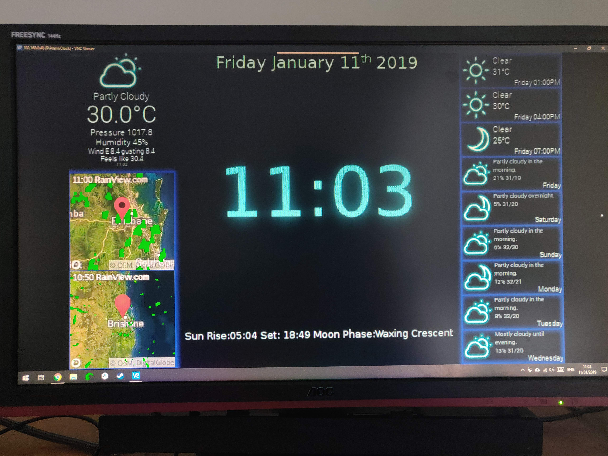
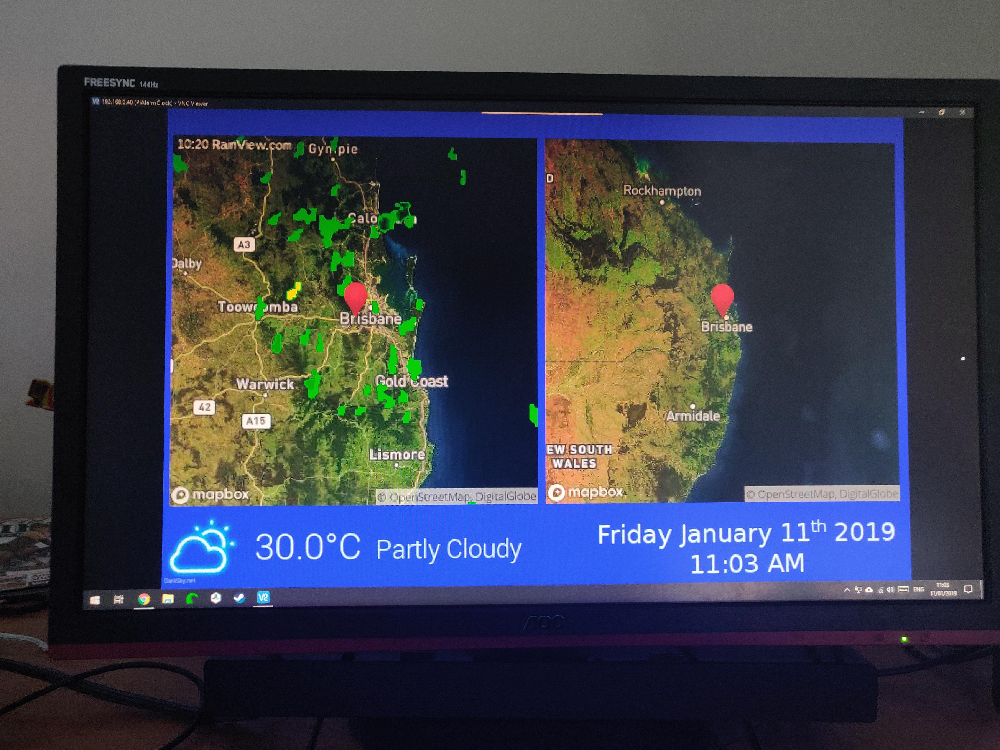
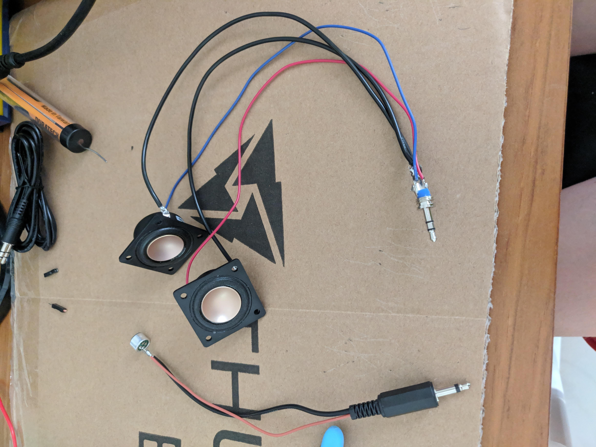
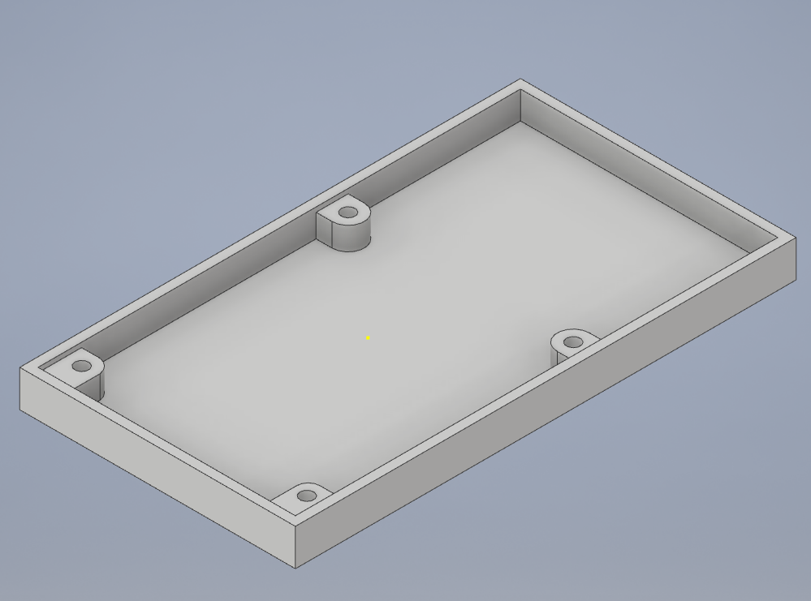

This post is the first in a series over the next few weeks (maybe months) where I will document my current project of building a Raspberry Pi powered Alarm Clock with PiClock and the Google Assistant.

Because I have had the Raspberry Pi for a while, I started by connecting it to my computer and setting up the software. I started by setting up PiClock, which was a breeze as it had clear instructions on installation and setup. The Google Assistant was the hard part.

_PiClock running on my Computer (Screen 1 & 2)_

Both PiClock and the Google Assistant run in Python, so it will be easy to (later on) add the transcript from the Assistant to the alarm clock screen, as well as raise screen brightness when listening/ responding, etc.

Over the past few weeks I have been ordering and experimenting with the different components I will need to finish this project. In the beginning, I thought all I would need is a Raspberry Pi, a screen, a set of DIY speakers, and a DIY microphone. The first 2 parts have been as simple as they sound, but the speaker and the microphone have taken lots of time, as I have learned more than I could have imagined about them. Mainly, that speakers and microphones need amplifiers.

_DIY Microphone (Left) and DIY Speakers (Right)_

They both worked, it's just that the microphone was so quiet i would not hear it at even the highest volume, and I could hear the speakers at full volume, but they were still not the advertised 79db.

While I'm waiting for the screen, speaker amplifier board and microphone to arrive, I have begun modelling the case I am going to print in my wood filament to make it look like an alarm clock. This will save me time when the parts arrive as I'll only have to change dimensions, not create the entire object model.

_Unfinished base of casing_

I will post updates whenever I work on aspects of this project, but it will take time to complete. The thig with DIY electronics though, is that when it works in the end, you have gained 3 things. Knowledge, experience and a useful device. 😉

Check out all the posts for this project [here](https://blog.crankshafttech.com/search/label/Raspberry%20Pi%20Alarm%20Clock)

.
