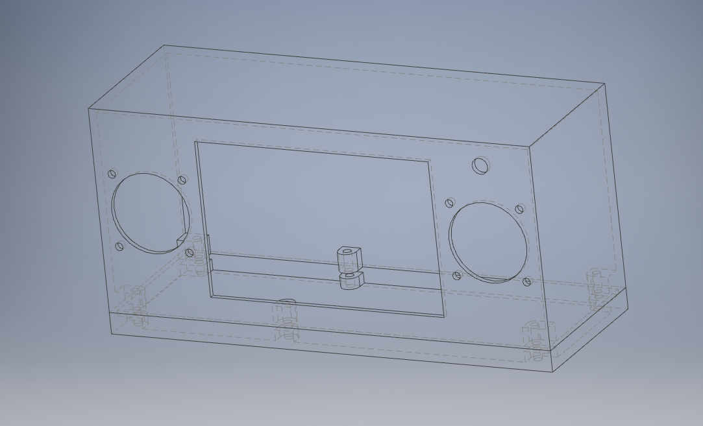
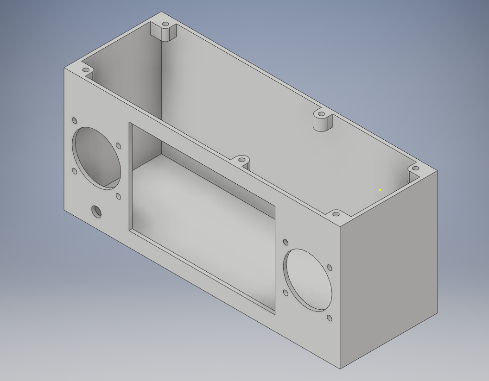
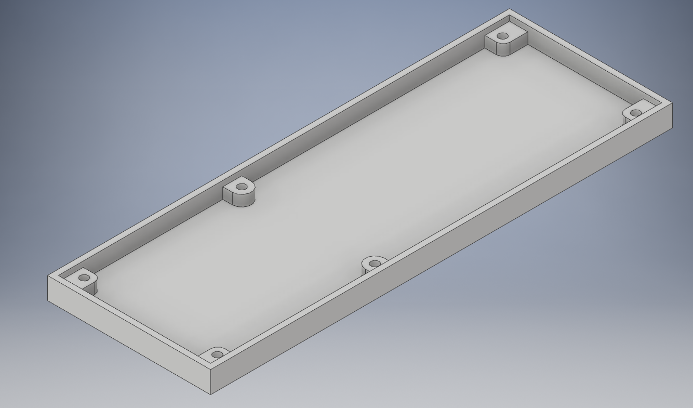

This is a quick update about the progress I made today on the casing.

I have finished modelling the casing to the best accuracy I can get without having all of the components to measure. It took many hours to model the top portion that will house the speakers, microphone and screen as well as cover the Raspberry Pi. It wasn't made easier by the many weird changes and "glitches" (aka occurrences I didn't understand or want) that occurred when I changed some dimensions, including sections of the models disappearing.

_The current state of the entire casing, represented as a wire frame. (Above)_

_The top (above) and base (below) of the casing_

This is all I was able to do today, as the rest of the components haven't arrived as of posting. I will release more updates as more parts arrive and changes are made to the model.

Check out all the posts for this project [here](/tags/raspberry-pi-alarm-clock/)

.
