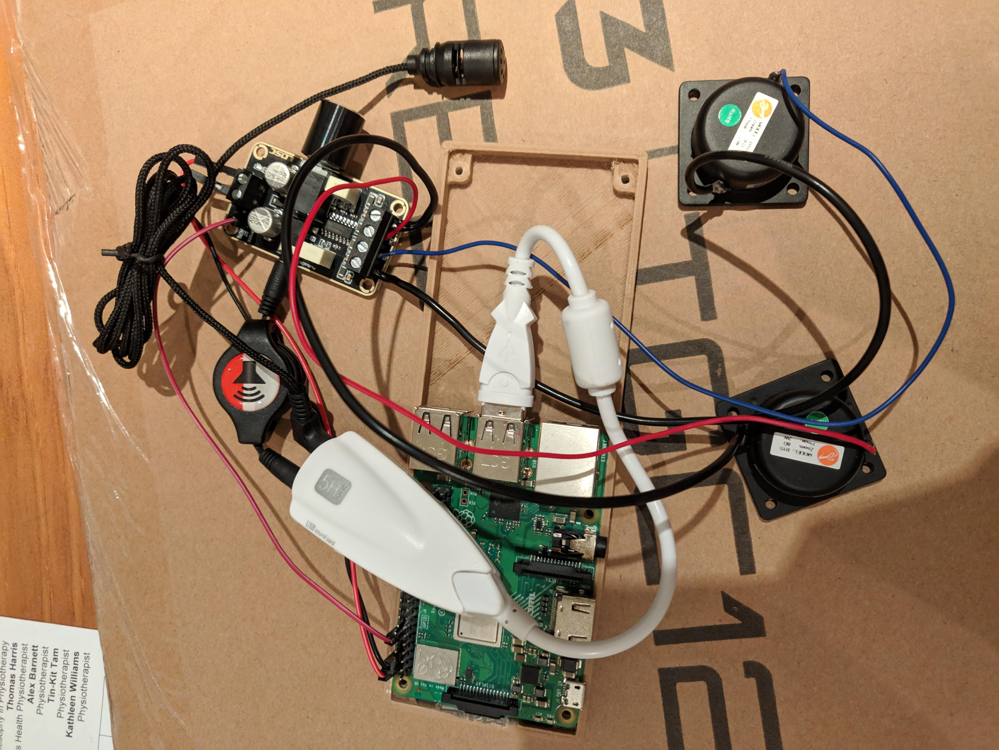
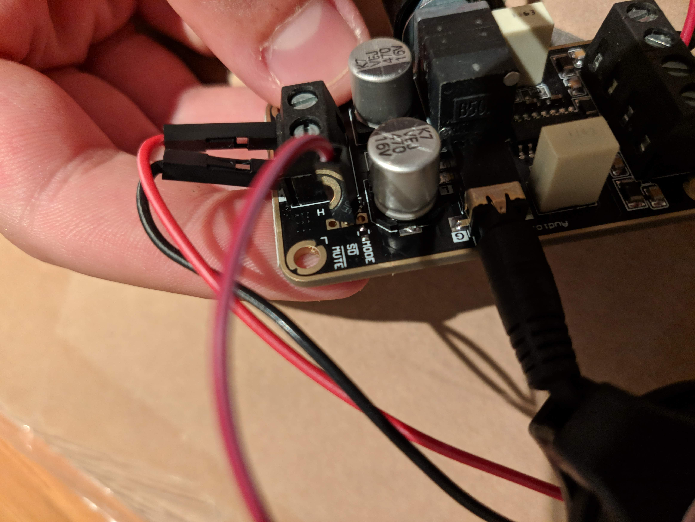

I am writing this update as I am returning to school and won't be as focused on this project Future updates will be posted, but here is a summary of everything that has occurred since the last update.

All of the parts have arrived except for the screen which has allowed me to setup and test the "final" hardware, including the microphone, speakers with amp, and all of the code.

The amplifier makes the speaker REALLY loud, and the microphone is adequate, but I hope to upgrade to a

[MEMS](https://os.mbed.com/users/4180_1/notebook/using-a-microphone-for-audio-input/)

microphone.

_The (almost) complete hardware, including Amp (top), Microphone (right), USB DAC (Left), Raspberry Pi (Far Left) and Stereo Speakers (Bottom)_

The first problem I encountered was the microphone being used by another unknown process that took me a few hours to find and stop, which has not started again even after reboots. Once this was fixed, I was able to successfully start the Assistant script.

After that, the speakers gave out a persistent buzzing sound that was very annoying. I first looked into how to stop it, but couldn't figure it out. The next method I discovered to combat this was to use a standby pin built into the Amp which when grounded mutes it, and when not it plays audio. Using this idea, I found a file in the OS (thanks to stack exchange) that states whether or not audio is being sent to the speakers, which I then used in a script which constantly reads this file and mutes the amp unless there is audio being sent. Success! The buzzing still occurs in the background when audio is playing, but this will do until I figure out to fix it.

_The standby pin used to prevent buzzing (Labelled SD)_

A final note is that I clogged my 3D printer while printing a part for someone else which prevented the extruder motor from rotating which in the end killed it. This means I can not print the top of the casing until I can replace the whole extruder. This will delay the final product.

The list of future software additions to this project include playing a sound when the Assistant is listening and thinking, and eventually getting the Assistant's response as a visual text output on the clock face. Also, I hope to be able to adjust the screen brightness according to time of day and if the assistant is interacting with the user or not. This is all for another update.

If you have any feedback, questions or answers to my problems, please leave a comment.

Check out all the posts for this project

[here](https://blog.crankshafttech.com/search/label/Raspberry%20Pi%20Alarm%20Clock)

.
