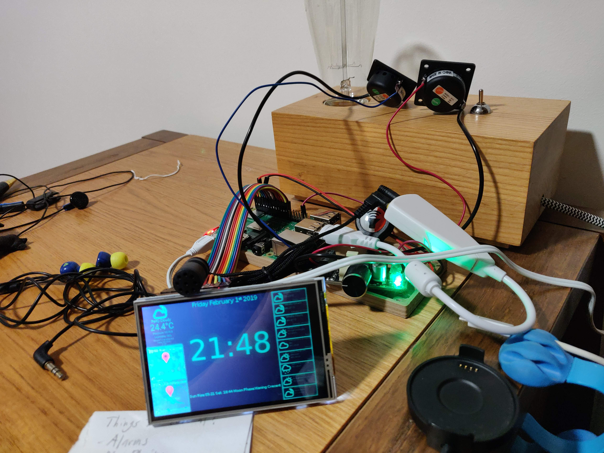
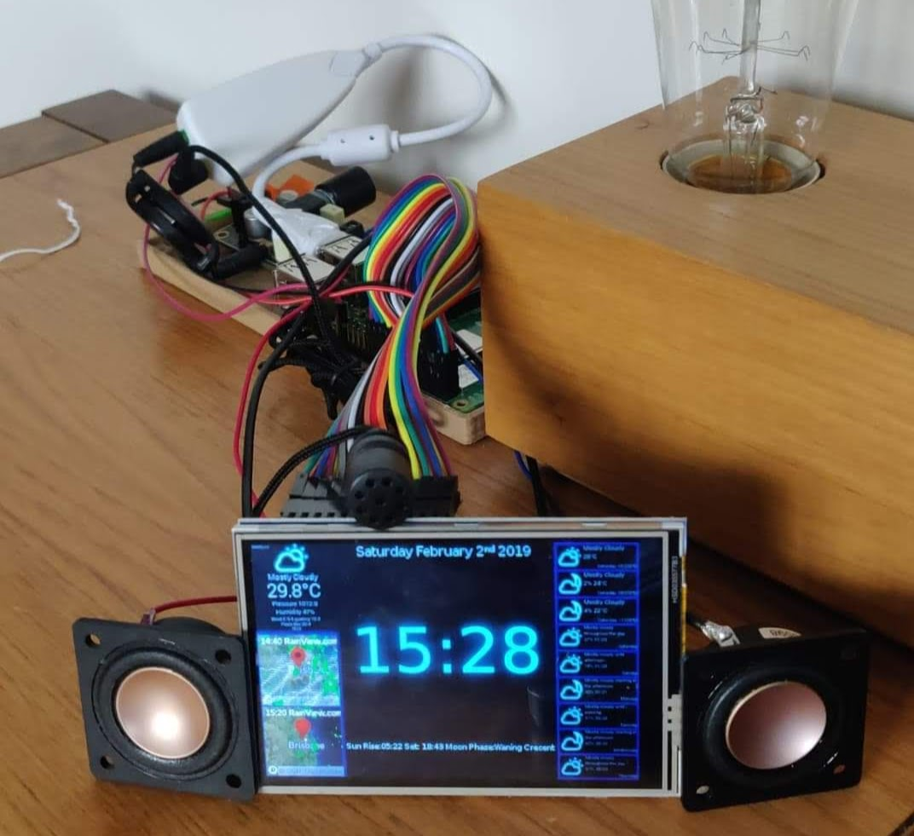

School has been kind on homework, so I have had time to make some HUGE advancements in the project.

Firstly, I have setup the PiClock switcher script with a day and night theme.

_Night Theme (Above) and Day Theme (Below). They are green and blue respectively_

Also, it has now replaced my Google Home Mini as my alarm clock. It has been setup for a few days and has worked well except for the alarms being strangely quiet, but still audible. I attempted a fix but it kept crashing. Despite this, I did notice that it keeps alarms between reboots, which is handy.

Just this weekend I setup the coolest and most time-consuming feature, internet radio. I have currently setup one radio station which plays when you say 'start action 1', which when used with routines, can be changed to something like 'custom radio', which is what I use.

It is currently setup to play until it hears the hotword again. It requires a custom action in the Actions Console and code on the Pi (instructions: [https://bit.ly/2WGXp0p](https://bit.ly/2WGXp0p)) for when it receives the command, which then executes the VLC library (`python-vlc`) which plays the stream. It could also be utilised to play local music files, but I have not tested and implemented this. I hope to set it up in the future to play until I send it the stop command, even after queries, but I ran out of time and concentration and it kept crashing. It will only take another weekend. 😉

Finally, I have setup a GitHub repository which I will upload my code and more detailed instructions to for this project. It can be accessed here: [https://github.com/hasmar04/PiAlarmClock](https://github.com/hasmar04/PiAlarmClock)

If you have any feedback, questions or answers to my problems, please leave a comment.

Check out all the posts for this project [here](/tags/raspberry-pi-alarm-clock/).
