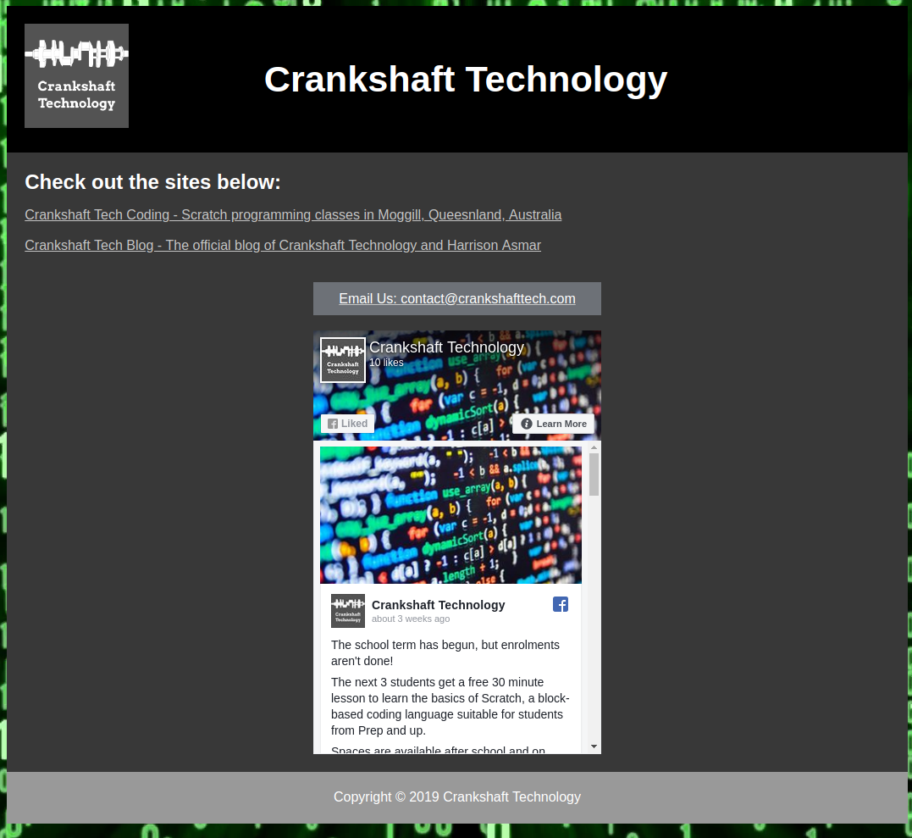

Over the past few weeks, as I started learning HTML again, I decided to use one of the tutorials from school to make a new custom website for

[www.crankshafttech.com](http://www.crankshafttech.com/)

.

I started from scratch and coded the entire website, from the content to the layout. This has taken many hours to complete, and will take many more to perfect.

The main features of the website include:

- A live Facebook feed of posts
- Links to the blog and the coding site
- An email us button
- Adaptive layout and size relative to screen size

_www.crankshafttech.com_

Using what I have learned from this site, I am now working on a similar solution for

[coding.crankshafttech.com](http://coding.crankshafttech.com/)

, but it is still in active development.

The framework is complete, but with all the extra elements, it is much harder to make it adaptive and look good on both mobile and desktop browsers.

_test.crankshafttech.com_

If you would like to check out the beta version of the site, it can be accessed at

[test.crankshafttech.com](http://test.crankshafttech.com/)

.

Please leave a comment if you have any feedback or questions.

The other updates for Crankshaft Technology can be found

[here](https://blog.crankshafttech.com/search/label/Crankshaft%20Technology)
