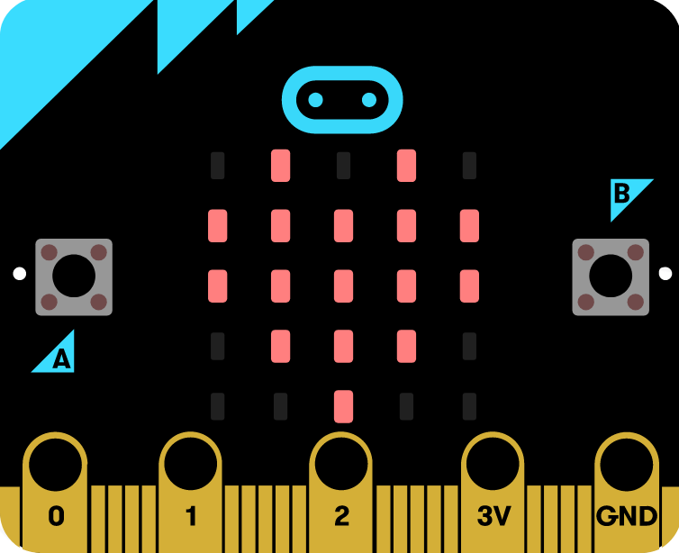
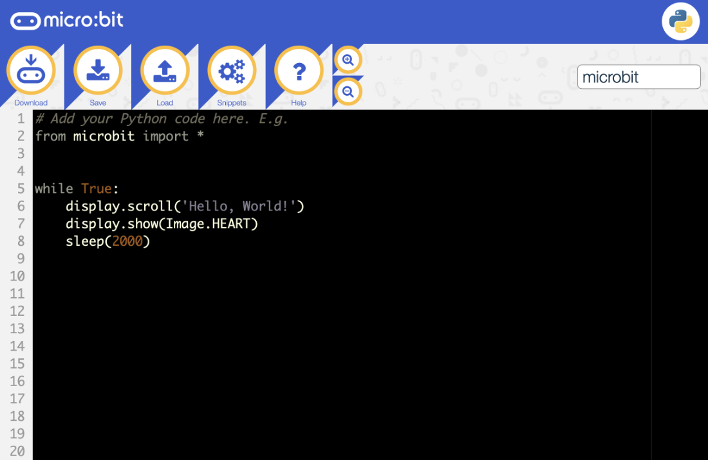
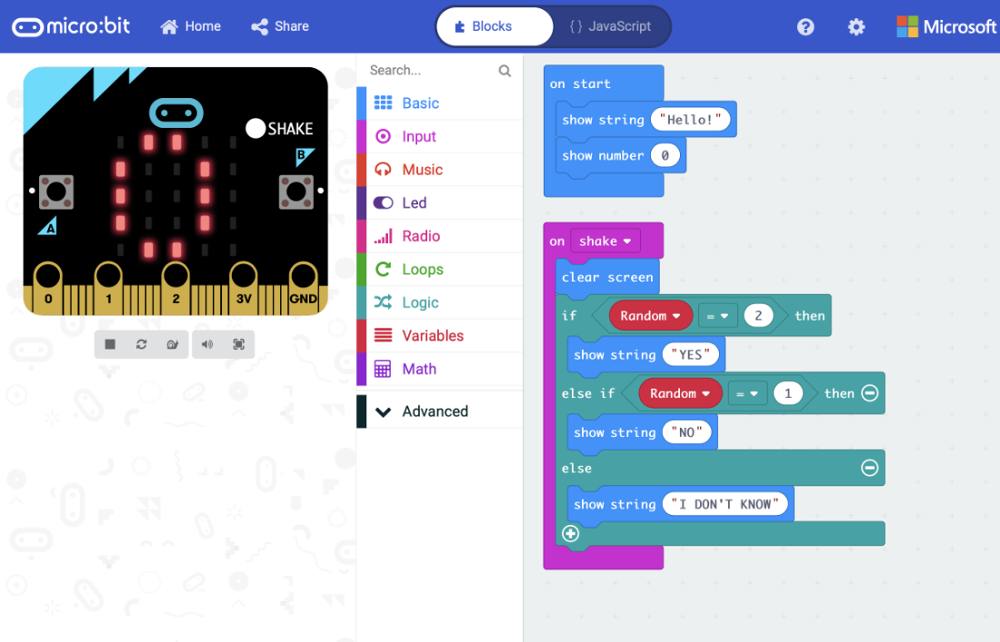

A local student recently asked me for some assistance with his Micro:Bit code for an assessment. I was able to help him, and I also learned how useful Micro:Bit's can be in education. They're cheap, easy to code and scalable for any ability. This is why I have purchased one, and sessions are now available these holidays and next term!

_The Micro:Bit board_

The benefits of these boards are that they have physical outputs and inputs, including LED's and buttons. I have found that, even with myself, hardware that you code is more interesting than text or shapes on a screen.

Another benefit of the Micro:Bit is that it has many different ways of programming it. These include [MakeCode](https://makecode.microbit.org/), a Scratch-style block-based language, [MicroPython](https://python.microbit.org/editor.html), a text-based language that is based on [Python](https://www.python.org/), a powerful scripting language used throughout the technology industry, and [Arduino](https://www.arduino.cc/). This allows the board to be used with many age levels and it can be scaled to suit the ability of the student.

_MicroPython editor_

_MakeCode editor_

All of the code editors and tutorials are web-based, and work on any computer that you can connect the Micro:Bit to and has a web browser (all modern computers), so code can be worked on at home!

If this is popular, I would like to buy another, which allows even cooler programs to be made, including having the boards communicate and control one-another.

To reflect these additions to the program, I have updated the website with some more information about the board. The page can be found[here](https://coding.crankshafttech.com/WhatIsMicroBit.html).

Please leave a comment if you have any feedback or questions.

The other updates for Crankshaft Technology can be found

[here](/tags/crankshaft-technology/)
