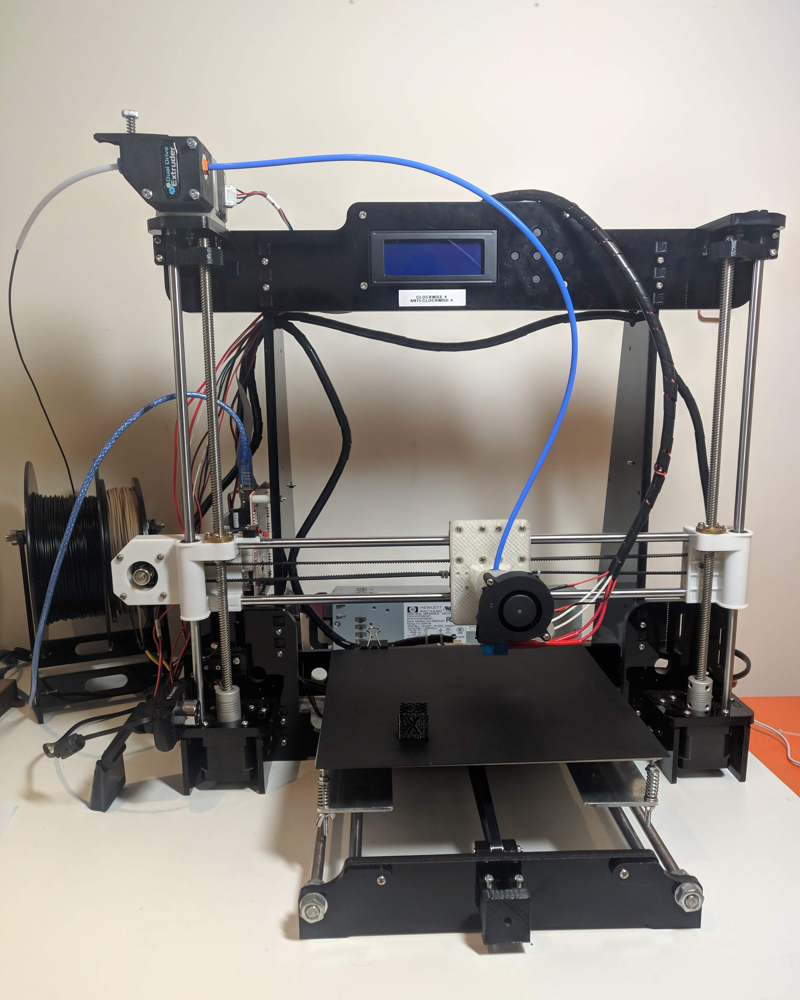
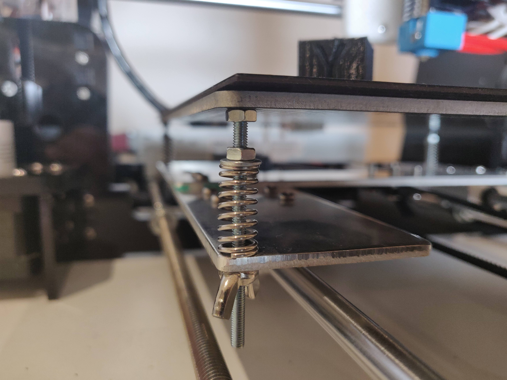
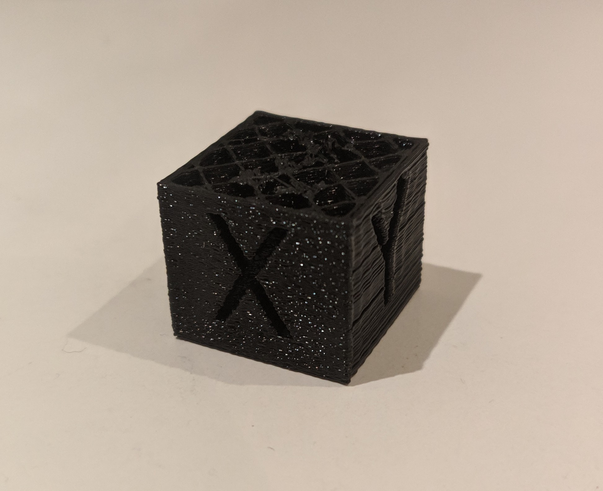

I recently finished repairing and upgrading my Anet A8 3D printer, and thought I'd share some in-depth information about the build here.

_The assembled printer_

The process has taken around 6 months and nearly everything has been upgraded. This includes:

The hotend was upgraded from the Anet stock to the [Trianglelab V6](https://www.aliexpress.com/item/32844028127.html?spm=a2g0s.9042311.0.0.35584c4dERtAXq),
The extruder type has been changed to a bowden, which means the motor is mounted to the frame and not the hotend carriage, allowing faster and finer movements, as well as less strain on the X axis motor,
The extruder motor has been upgraded to a [Trianglelab NEMA17 48mm stepper motor](https://www.aliexpress.com/item/32878690112.html?spm=a2g0s.9042311.0.0.35584c4dERtAXq) with a 0.9 degree step, which allows for even finer control over extrusion,
The extruder gears have been upgraded to the [Trianglelab BMG clone](https://www.aliexpress.com/item/32950787714.html?spm=a2g0s.9042311.0.0.35584c4dERtAXq), which has easier filament insertion, higher quality gears and a great gear ratio,
Heatbed glass was dropped and then replaced with a [magnetic bed](https://www.aliexpress.com/item/32881083096.html?spm=a2g0s.9042311.0.0.35584c4dERtAXq), which allows the print bed to be removed and flexed to easily un-stick prints.

It is a long list, but that is still not everything. Something had to go wrong when I was replacing this many parts. The main issue was the power supply. Anet stock power supplies are notorious for being dangerous, as there is only a thin piece of plastic between pins and the metal housing. It finally decided to die, and go out with a bang, literally.

I turned it on a few months ago to nothing. Thinking the mainboard was dead, I bought a new one, going from version 1.5 to 1.7 of the stock Anet board. Once this arrived, I wired everything up and it still didn't turn on at first, only this time it eventually came to life. The only problem was that the power supply also began to start throwing large sparks. I instantly turned it off, and ordered a replacement, which ended up being a HP DPS-600PB 12V server power supply. Once it arrived, I had a [great guide](https://www.rcgroups.com/forums/showthread.php?2371780-Clean-Elegant-way-to-short-the-Pins-on-HP-DPS-600PB) which showed me which pins to connect to force it to power on. Once I soldered the right pins, it worked flawlessly, albeit loudly.

Once I had all the parts, it took me an entire weekend to assemble.

The final issue I encountered was not having long enough screws to account for the higher nozzle because of the new bracket. I ended up getting some 50mm screws which worked perfectly, except for that they were so long they hit the frame and prevented the bed from moving properly. To overcome this, I raised the extruder even higher and used some nuts to allow the springs to be 'long enough', by putting a gap between the bed and the spring. This worked great, and I now have even better adjustablility for levelling the bed. 

_The spring and bolt bed height setup._

Once I had the hardware set up, I needed to configure the software. I uploaded marlin to the new mainboard and then read that I should calibrate the esteps, which is how many steps of the stepper motor represents 1mm. Mine ended up being around 800.

Now that everything was configured, I ran a test print using my existing slicer settings, albeit a lot slower. It was a total failure at first. The first print didn't stick and the second one didn't seem to extrude. Third time luck I was, as I successfully printed 3/4 of a calibration cube until the software on my laptop crashed and cancelled the print, but what was printed was in acceptable quality for a first successful print.

_The first print_

This is a long post, but I wanted to leave all the details here if anyone else was doing a similar upgrade and so I have a record of what I did.

Please leave a comment if you have any feedback or questions.

My other personal updates can be found [here](https://blog.crankshafttech.com/search/label/Personal%20Update)
