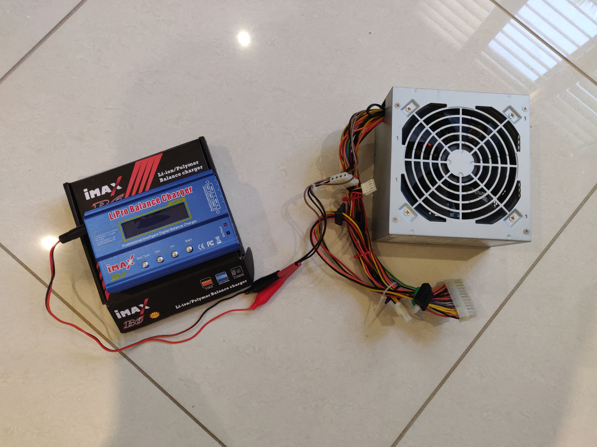

I have always been interested in aviation and Remote Control technology, and when I recently visited the World Science Week festival in Brisbane and saw the racing drones military personnel use, I was instantly intrigued.

Over the last couple of months, I have been attempting to build an FPV (First person view) racing drone for myself. I have not completed it yet, after almost 3 months, due to slow shipping and broken parts. I should have posted this a while ago, but here is what I have done so far:

After a few weeks of researching, I came up with my final parts list:

Frame: [Link](https://www.ebay.com.au/itm/3K-Full-Carbon-Fiber-QAV210-FPV-Racing-Quadcopter-Mini-Drone-Frame-Bumper-Kit-GL/312391601952?ssPageName=STRK%3AMEBIDX%3AIT&_trksid=p2057872.m2749.l2649)

Flight Controller: [Link](https://www.ebay.com.au/itm/Betaflight-Omnibus-STM32F4-F4-Pro-V3-Flight-Controller-Built-in-OSD-RA/401670272277?ssPageName=STRK%3AMEBIDX%3AIT&_trksid=p2057872.m2749.l2649)

Motors: [Link](https://www.ebay.com.au/itm/4Pcs-Set-Brushless-Motor-Emax-RS2205-2300KV-CCW-CW-Drone-Racing-Quadcopters-AU/192853511682?epid=13023715045&hash=item2ce6f70e02:g:tQ4AAOSwwRtchbjf&frcectupt=true)

Electronic Speed Controllers (ESCs): [Link](https://www.ebay.com.au/itm/NEW-Racerstar-RS30A-V2-30A-Blheli-S-ESC-OPTO-2-4S-Support-Oneshot42-Multisho/263104855877?ssPageName=STRK%3AMEBIDX%3AIT&_trksid=p2057872.m2749.l2649)

Video Transmitter (VTX): [Link](https://www.ebay.com.au/itm/Eachine-VTX03-Super-Mini-5-8G-72CH-0-25mW-50mw-200mW-Switchable-FPV-Transmitter/122761144109?ssPageName=STRK%3AMEBIDX%3AIT&_trksid=p2057872.m2749.l2649)

Camera: [Link](https://hobbyking.com/en_us/turnigy-hs1177-v2-1-3-sony-color-had-ii-ccd-camera-for-fpv-pal.html)

Video Receiver/ Headset: [Link](https://www.ebay.com.au/itm/008D-PRO-5-8G-4-3inch-Screen-FPV-RC-Drone-Goggles-Dual-Antennas-Mini-USB-DVR-AU/303251894508?ssPageName=STRK%3AMEBIDX%3AIT&_trksid=p2057872.m2749.l2649)

Transmitter and receiver: [Link](https://www.ebay.com.au/itm/Flysky-FS-i6X-2-4GHz-AFHDS-2A-RC-10CH-Transmitter-REMOTE-X6B-i-BUS-Receiver-AU/233194111747?ssPageName=STRK%3AMEBIDX%3AIT&var=532693337556&_trksid=p2057872.m2749.l2649)

Battery: [Link](https://hobbyking.com/en_us/turnigy-graphene-panther-1500mah-3s-75c-battery-pack-w-xt60.html)

This is most of the stuff I needed to get started. I also needed a battery charger ([Link](https://www.ebay.com.au/itm/iMax-B6AC-80W-RC-Lipo-Lithium-NiMh-Digital-Battery-Balance-Charger-Discharger-M3/283511686408?ssPageName=STRK%3AMEBIDX%3AIT&_trksid=p2057872.m2749.l2649)) and a power supply for the charger, which I made out of an old desktop power supply (PSU). To plug the battery into the charger, I needed a special cable ([Link](https://www.ebay.com.au/itm/14AWG-Male-Banana-Connector-To-XT60-Plug-Male-Wire-Adapter-Cable-Converter-DR/392274070730?ssPageName=STRK%3AMEBIDX%3AIT&_trksid=p2057872.m2749.l2649)). I also needed a cable to plug the battery into the flight controller ([Link](https://hobbyking.com/en_us/xt60-male-w-12awg-silicon-wire-10cm-5pcs-bag.html))

_The DIY Power Supply and Charger (not as dangerous as you think)_

I first received the flight controller, frame, VTX and camera, which I assembled by soldering the wires to the flight controller and VTX. I then plugged it into my laptop, turned on my headset and checked to see if it was transmitting video. Once I found the right channel, I got an image. Then, I opened Betaflight Configurator ([Link](https://github.com/betaflight/betaflight-configurator)) and added some more information to the On Screen Display (OSD), which allowed me to see altitude, speed, direction and battery voltage.

_Betaflight Configurator_

As of writing, I have received all the parts except for the replacement for my broken motor.

New posts will be written as parts arrive and are assembled.

Please leave a comment if you have any feedback or questions.

My other personal updates can be found [here](/tags/personal-update/), and DIY Drone updates can be found [here](/tags/diy-drone/).
