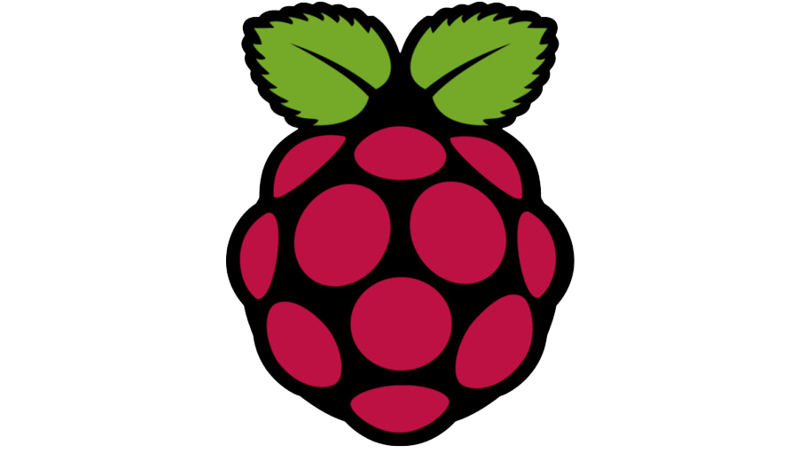
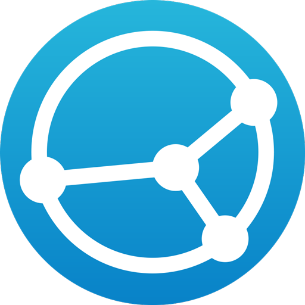
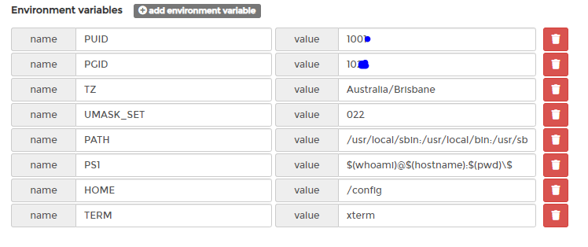

This tutorial uses a Raspberry Pi, but it is a use case different from my last tutorial: a home NAS (Network-Attached-Storage) that is compact and doesn't consume much power. Also, it is relatively cheap to setup compared to ready-made solutions from Synology and others.

I have been using a Raspberry Pi 3B+ (read disadvantages below) for a few weeks, and it has worked great for my needs. I recentyly switched to a Pi 4 to test this tutorial before I publish it. Both setups allowed me to create a network drive for all our movies that anyone on the network can access, while keeping a password-protected section for my own private files.

_OpenMediaVault and Syncthing logos_

## What this tutorial includes:

How to setup OpenMediaVault on a Raspberry Pi with Samba (SMB)
How to setup Syncthing to have Google Drive/OneDrive style syncing to your computer

Syncthing can be installed separately from OpenMediaVault by slightly tweaking these instructions, but this tutorial is intended for OMV.

## Equipment Required:

Raspberry Pi (Raspberry Pi 4 strongly recommended, disadvantages of others below)
Micro-SD Card (16GB minimum, 32GB+ recommended)
USB Micro-SD card reader or an SD card slot and a Micro to Full adapter
USB mass storage drive in the form of:

a SATA HDD/SSD in a SATA to USB adaptor
a USB Hard Drive/SSD

Power Adaptor that can provide the full power required for the Pi and the drive. 

Disadvantages of not using a Raspberry Pi 4:

The Raspberry Pi 4 is the first Pi to include 3 important features for a NAS:

USB 3.0 ports
True Gigabit Ethernet
The option for more than 1GB of RAM

These features make for a much more usable NAS, and the Pi 4 is the first Pi that the creators of OpenMediaVault recommend because of these features.

If you do not have a Pi 4, it will still work, but you may notice some performance issues, with the drives being throttled by the USB 2.0 ports or the non-gigabit Ethernet.

I have setup a NAS using a PI 3B+, and the only problem I have encountered is Syncthing filling the 1GB of memory and crashing. I am upgrading to a 2GB Pi 4 in the future, and this should alleviate this issue. More info on this issue can be found [here](https://github.com/syncthing/syncthing/issues/1642).

## Downloads Required:

Raspbian Lite from [here](https://www.raspberrypi.org/downloads/raspbian/) (can use full, but not necessary and uses alot more space)
Balena Etcher from [here](https://www.balena.io/etcher/)
Syncthing desktop client from [here](https://syncthing.net/downloads/)
(Optional) Angry IP Scanner from [here](https://angryip.org/download/)

_Raspberry Pi / Raspbian Logo_

Before starting this tutorial:

This is a forewarning that **it is strongly recommended you have full backups of your files in case something goes wrong.**

I have tried my best to make sure nothing does go wrong, but a misspelling of a command or clicking the wrong button **can lead to data loss.**

**I am not resposnsible or liable if you lose any files, and you proceed at your OWN RISK.**

Flashing and Setting up Raspbian:

Extract the Raspbian Lite zip file
Install Etcher and run it as an Administrator. select the Raspbian Image and the SD Card for the Pi, double check you've selected the right SD card, and hit flash and wait a few minutes while it copies. 
To be able to gain access to the command line remotely, SSH access is required. This can be done by accessing the Windows readable partition of the SD Card (/boot) and creating an empty file called "ssh" or "ssh.txt". This is case-sensitive. Now SSH access will be enabled. 
Insert the micro SD card into the Pi, plug in the Ethernet and then power it on. 
Find the IP address of the Pi by either going to your router/switch control panel and looking for "raspberrypi" in connected devices or by downloading and using an IP scanner like Angry IP Scanner. Make sure you enter the correct IP range of your network. Once again look for "raspberrypi". 
Once you have found the IP address, go to Command Prompt or Terminal and enter:
ssh pi@[IP ADDRESS]
The default password is "raspberry". 
Once your are logged in, it is strongly advised you change the default password. This can be done by entering:
passwd
This will ask for the current password, then the password you want to set. 
One more recommended thing is to upgrade all your packages. This can be done by entering:
sudo apt update
sudo apt upgrade
This may take a few minutes, depending if you installed the lite version or the full. Once complete, type:
sudo reboot
Once it has rebooted, reconnect using SSH and type:
sudo raspi-config
This menu allows you to change many settings on the Raspberry Pi, including setting up a WiFi connection if your board supports it, as well as setting up localisation and many other things. 
In this menu, use the arrow keys to navigate to "Localisation Options" and hit Enter.
Change your Locale and Timezone to make sure your time and location are set correctly. 
Once finished, use the arrow keys to select "Back", then hit Enter.
Go to 'Network Options" and hit Enter.
Select "Hostname" and click Enter. This allows you to change the name or your Pi.
Read the warning/instructions and enter the new hostname. Once complete, hit Enter.
If it asks you to reboot, hit "Yes"

_OpenMediaVault logo_

Installing OpenMediaVault (OMV):

Source instructions: [here](https://github.com/OpenMediaVault-Plugin-Developers/docs/blob/master/Adden-B-Installing_OMV5_on_an%20R-PI.pdf)

Connect using SSH to the Raspberry Pi.
Enter this command:
wget -O - https://github.com/OpenMediaVault-Plugin-Developers/installScript/raw/master/install | sudo bash
Wait for the script above to finish. It should take about 30 minutes, so you can get a cup of tea or coffee. 
Once it is complete, type the reboot command into the command line:
sudo reboot
After a few minutes you should be able to access the web interface of OMV from the web browser by entering the IP address you used for SSH earlier. The default username is admin and the default password is openmediavault

Once you are logged into the interface, Go to the System section on the left, click General Settings, then go the the Web Administration Password tab. In here, you will be asked to enter a new password twice. This is strongly recommended to prevent unauthorised access. 
Next, go the the Network section under System. Go to the interfaces tab and click Add. 
Select Ethernet from the dropdown. 
In the name section, select the Ethernet interface you want to use (default is eth0)
In the method dropdown, select DHCP
Click on Save
Wait for the yellow banner to appear, then click Apply and then Apply in the confirmation dialogue. 
While we are on networking, it is useful to set a static IP on your router for your NAS to make sure that the IP address doesn't change when it is restarted. To find how to do it for your router, do a quick Google search for your router model followed by "IP reservation". 

Setting up the Drive:

Plug in your USB storage device you want to use (If it is a USB 3 drive with a Pi 4, make sure the USB 3 plug goes in the blue port).
Open the OpenMediaVault control panel using it's IP Address.
Go to the storage section on the left.
Click on the Disks section
There should be at least 2 drives, the SD Card which starts with /dev/mmc, and your USB storage device, which is with /dev/sdX, where the X represents which drive. "sda1" is the first drive and so-on. 

For your USB storage, it is recommended to use the EXT4 filesystem as it has full support for all features. If your drive uses one of the following filesystems, you do not need to erase the drive and can mount it straight away:

EXT4
EXT3
JFS
XFS
BTRFS
NTFS (no format support)
HFSPLUS (no format support)
UFS (no format support)
VFAT (no format support)

NOTE: No format support means that if you wipe the drive you cannot format it with that filesystem. 

You can check what filesystem your drive uses in the File Systems section under Storage on the web GUI. 

If your drive does not use one of the above filesystems, follow the steps below:

**Any files you want to keep on the drive should be backed up, as you are about to erase it.**
Once the drive is backed up, click on it so it is highlighted yellow, then click wipe up the top. 
Click yes to any confirmation that appears. **THIS ERASES THE DRIVE!**
Once that is complete, go to the File Systems tab under storage. 
Click on Create up the top.
In the first drop-down box, select the drive you want to use. This is /dev/sdX. 
Enter a label underneath to remember what the drive is for in the future. 
In the File System drop-down, make sure EXT4 is selected. 
Once everything is set, click OK. 
Wait for the yellow confirmation banner, than click apply and yes to the confirmation. 

Once your drive has a supported filesystem, continue from here:

In the File Systems section, click on the drive you want to use. 
If the Mounted column does not say yes next to your drive, click Mount up the top. If it is not mounted and the button is greyed out, you are using an incompatible filesystem. 

Creating the Network Folder:

Go to the Shared Folders menu under Access Rights Management. 
Click on Add. 
In the name box, enter the name of the folder as it will appear on the network. 
In the device drop-down, select the drive we mounted earlier. 
Leave the permissions as default unless you know what you are doing. 
Click Save once complete. 
If you want to create multiple folders on the same drive, follow this section again. 

Making the network folder accessible by anyone on the network:

Go the Access Rights Management and click on Shared Folders. 
Click on the folder you want accessible and then click ACL. 
This menu allows you to change user permissions
Leave the owner as root, and make sure it has Read/Write/Execute permissions. 
Leave the group as users, but make sure the permissions as Read/Write/Execute. 
Click Apply. 

The folder now has the correct permissions to be accessed by any logged in user. We will add guest access later. 

Making the Network folder accessible to only certain users:

Go to the User section under Access Rights Management
Click on Add. 
Enter the username in the Name box. 
Enter the password in both the Password and Confirm Password boxes. 
I usually change the shell to /bin/bash, but you can leave it as the default. 
Click on the Groups tab. 
Select the groups you want them to be in. Common ones include:

sambashare - required for later, allows access to samba shares
sudo - for superuser priveleges
ssh - you can use this user to login via ssh
crontab - allows you to edit the cron scheduling

Once you have selected the groups you want, click Save. 
Click on the new user then click Privileges. 
Tick the Read/Write column on the Folder you want to give the user access to. 
Click Save. 
Wait for the yellow confirmation banner and click Yes. 
Follow steps 1 to 4 from above. 
Leave the group as users but set the permissions to none. 
Set the permissions for others to none. 
In the section on the top-right, select tick the box in the Read/Write column for the user you want to allow access. 
Once everything is set, click Apply. 

Making the folder accessible on the network:

I will be explaining how to setup Samba (SMB) to access the files from a Windows, Mac or Linux machine.

Go to the Services section and click on SMB/CIFS. 
Go to the shares tab. 
Click Add. 
Select the folder you created earlier. 
In the Public drop-down box, select No if you want the drive only accessible to the users specified in earlier steps, or select Guests allowed if you want it accessible by anyone. 
Tick the read-only box if you require it. 
Make sure Set browseable is selected if you want the drive to be visible on the network. 
If you want a recycle bin, scroll down and turn it on, as well as set max file sizes and how long until it should auto empty. 
Once everything is set, click Save. 
Go back to the Settings tab and turn on the Enable toggle. Click save and yes to any confirmations. 
Now the folder should be visible and accessible on the network!

_Syncthing logo_

Setting up Syncthing:

There are a few ways to setup Syncthing. On OpenMediaVault 4 there is an plugin to make it super easy, but on OMV 5 this does not exist. Instead, I will explain how to set it up in Docker.

Login to the OpenMediaVault page. 
Go to the OMV-Extras Section under System. 
Click on Install Docker. Leave the Docker Storage location as the default unless you know what you are doing. 
Wait for the close button to not be greyed out, then click it. 
Scroll down to Portainer and click Install Portainer. This installs a web GUI to manage containers. 
Once again, wait for the close button not to be greyed out, then click it. 
Once both Docker and Portainer are installed, click on Open Portainer web interface. 
It will ask for a username and password to create the user account. Enter credentials and hit Enter. 
It will now ask if you want to manage Local or Remote containers. As syncthing will be running on the same Pi, click on Local. 
It should now open up the main screen with the local Endpoint. Click on it to show more info. 
Click on Images. 
Make sure the registry is set to DockerHub, then in the box below type this:
linuxserver/syncthing
It should autocomplete with :latest on the end. Click pull image to download it. 

Creating the Docker Container:

There are 2 ways to create the container with the recommended configuration. One uses the Portainer GUI and the other is a single command in the command line. Both achieve the same result. 

Source: [https://hub.docker.com/r/linuxserver/syncthing](https://hub.docker.com/r/linuxserver/syncthing)

Method 1: Command Line:

Enter the following command noting the lines you need to modify:

docker create \
  --name=syncthing \
  -e PUID=1000 \
  -e PGID=1000 \
  -e TZ=Europe/London \
  -e UMASK_SET=022 \
  -p 8384:8384 \
  -p 22000:22000 \
  -p 21027:21027/udp \
  -v /path/to/appdata/config:/config \
  -v /path/to/data1:/data1 \
  -v /path/to/data2:/data2 \
  --restart unless-stopped \
  linuxserver/syncthing

Replace the PUID (User ID) and PGID (Group ID) with the values for your user. These can be found by entering the following command:
id <username> where <username> is the name of your user for the root of the server. This can be pi or the user you may have used for access to a password protected share.
NOTE: This user or the group the user is in must own the folder/s you want to sync, otherwise permission errors will occur. More info can be found [here](https://medium.com/@nielssj/docker-volumes-and-file-system-permissions-772c1aee23ca). 
This will return your UID and GID. Substitute these into the lines above. 
Next is TZ which stands for timezone. Basically just replace it with your Continent and City. 
Leave the UMASK as the default. 
Leave the 3 port lines as default these are for discovery and the syncthing web GUI. 
If you know where to save the configuration data for Syncthing, you can add the 3rd line, otherwise remove it completely so it uses the default. 
The next 2 are very important. They both create a binded folder so Docker can access the files on your host system. The first part is the location you want to store your files on your host filesystem. This can be set as a folder in /sharedfolders or somewhere else. Any files placed in this folder will be visible to the container.
The second part after the colon is the location the folder is bound to in the container. In my case, I set it to /var/syncthing, but you can do it somewhere else. Just remember where for later. 
If you have other folders you want to use with syncthing, just repeat the line above. 
Leave the restart line as is. 
Leave the last line as is as this defines the image you want to use. 

Once you hit enter, the container should be created and visible in Portainer. 

Method 2: Portainer GUI:

Go to Volumes on the left. 
Click on Add Volume. 
Enter a name for the volume. I used "syncthing_config", as this is where the configuration will be saved. 
Click Create the Volume. 
Go to containers on the left. 
Click on Add Container. 
Enter a name for the container, probably "syncthing". 
In the Image box, enter "linuxserver/syncthing" and click on it when it appears in a dropdown. This selects the image we want to use. 
Scroll down the Network ports configuration. 
Click on publish a new network port 3 times. 
Enter the following values into each:
21027 → 21027 UDP
8384 → 8384 TCP
22000 → 22000 TCP
Scroll down to advanced container settings. 
Go to the volumes tab. 
Click on map additional volume. 
Make sure Volume and Writable are selected. 
In the container box, enter /config
In the Volume box, select the volume we created earlier. 
Click on map additional volume again. 
This time, make sure Bind and Writable are selected. 
The the container box, enter where you want your syncthing files to be visible on the docker machine. I used "/var/syncthing".
In the host box, enter the directory of the files you want to sync with syncthing. If you want to sync files accessible in OMV, find the folder in /sharedfolders. Also, the address needs to be full, so no ~. 
If you want to sync multiple folders, you can repeat steps 18 to 21 as many times as you like. 
Go to the Env tab. This is the most tedious section. NOTE: For each new line, click on add environment variable. 
Create 2 new lines. Name one PUID, and the other PGID. 
To find the values, open an SSH session to your NAS and enter this command:
id <username> where <username> is the name of your user for the host OS of the server. This can be pi or the user you may have created for access to a password protected share. NOTE: This user or the group the user is in must own the folder/s you want to sync, otherwise permission errors will occur. More info can be found [here](https://medium.com/@nielssj/docker-volumes-and-file-system-permissions-772c1aee23ca). 
Substitute your UID and GUID into the respective value boxes. 
Create a third line with the name "TZ". In the value section, enter your Continent followed by your city. For example, mine is "Australia/Brisbane". 
In the next line enter the name "UMASK_SET" and the value "022". 
Next, enter the name "PATH" and the value "/usr/local/sbin:/usr/local/bin:/usr/sbin:/usr/bin:/sbin:/bin"
On the next line, enter "PS1" with the value "$(whoami)@$(hostname):$(pwd)\$"
Next, enter the name "HOME" with the value "/config" or wherever you made the volume on the container in step 16. 
Finally, enter the name "TERM" and the value "xterm". 
Once complete, it should look something like this:
Go to the restart policy tab. Select Unless Stopped. 
Unless you want to change something else and you know what you are doing, you are done configuring the container.
Click on Deploy the container. 

NOTE: If you did do something wrong, you can duplicate the container and make the changes necessary after it has been deployed. Just make sure you change the name. 

Accessing the GUI:

The web interface is accessed by entering your Pi's IP address followed by the port 8384. Example: http://192.168.1.2:8384
Once you are at the GUI, it will ask about anonymous usage collection. Select whichever you prefer. 
Next, there will be a box mentioning the fact that there is no username or password set yet. To set it, click on the popup or go to Actions, Settings, GUI where you enter a username and password for the Web GUI. 
once entered, click Save. 
You are now in the Syncthing GUI!

On the left side of the page are your folders that Syncthing can synchronise. On the right side at the top is the server information. Below that is a list of connected devices. This view is the same on computers that are syncing to the server.

The default folder is called "Default Folder". You should delete it.

The setup I deployed is that the Syncthing folder is in a folder that is also accessible over the network through samba so I can access my files on any device.

### Connecting a Remote Device:

### Install the applicable Syncthing desktop client from the link at the beginning of this tutorial. 
Open it once it is installed. It should show a similar interface to the server side. 
Go to the top right and click on Actions. 
Click on show ID. 
Copy the ID above the QR code. 
Go back to the server control panel by going to http://[PI IP ADDRESS]:8384
Click on Add Remote Device on the bottom right. 
Paste the Device ID into the box and Enter a name in the second box to remember what device it is. 
Once done, click Save. It should now appear on the right. 
Continue onto the next section.

### Creating a Folder:

To delete the default folder, click on the folder on the left followed by edit. 
Go down to the bottom left and select Remove. If any confirmation prompts appear, accept them. 
To create the new folder, click on Add Folder. 
Add a label so you remember what is in the folder. 
Leave the folder ID. 
Enter the path where the folder path that you bound before. My example used /var/syncthing, but enter the location you used. If the folder you bound contains files, it will make it syncable without modifying or deleting the files. 
Select the devices you want to sync the folder with. More devices can be added later. 
Click on Advanced settings. If you want to change if files are synced bi-directionally (Send & Receive) or Send Only, you can do so. 
Once everything is set, click on Save. 
The folder should appear on the left. 
Go back to the Syncthing client on your device. 
A yellow banner should appear at the top asking if you want to accept a folder being shared with you by another computer. Click accept and it should start syncing with the server. 
Syncthing is now configured!

NOTE: To add devices later, follow the Connecting a Remote Device steps, then click on the folder you want to share, click Edit, then tick the device and click Save. Then follow steps 11 to 13 above.

If you want real-time syncing, open the GUI client and click Edit on the folder. Go to the Advanced tab and tick the Watch for Changes box. Then click Save.

FINAL NOTE: If you have issues with slow scanning speeds / read speeds on Pi 4, follow the instructions at this link. This fixed it for me:
[https://www.raspberrypi.org/forums/viewtopic.php?t=245931](https://www.raspberrypi.org/forums/viewtopic.php?t=245931)

Hopefully this tutorial has helped you setup your own personal cloud using a Raspberry Pi.

Stay tuned, as I have another tutorial in the works on setting up Rclone to backup your files from your NAS to the cloud. You can get an alert by entering you email at the top of the page.

Please leave a comment if you have any feedback or questions.

You can check out my other tutorials [here](https://blog.crankshafttech.com/search/label/Tutorials).
