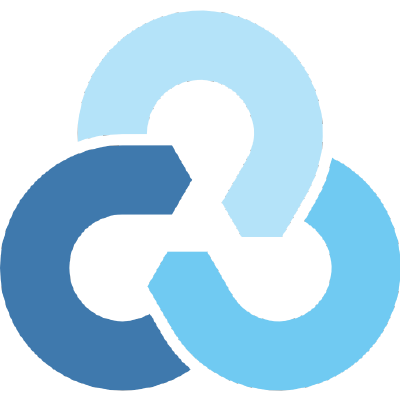

Rclone can be installed alongside my recent tutorial on [how to install OpenMediaVault with Syncthing](/posts/how-to-set-up-openmediavault-on-a-raspberry-pi-with-syncthing/), but it can also be installed on any modern Linux machine. This tutorial explains how to configure rclone to backup your files to a cloud storage provider of your choice. 
The setup I detail only allows rclone to read the files on the computer and copy them to cloud storage, and not modify the files on the computer. This means any changes to files on the cloud storage will not be synced to the computer, and that rclone cannot delete your files if you type the sync commands incorrectly.

{: width="200" height="300"}
_rclone logo_

## What is rclone?:

Rclone allows you to copy files to and from cloud storage over the command line. More information can be found [here](https://rclone.org/).

## Install rclone

Open a terminal session if installing locally or open an SSH session to the remote machine.
Install rclone via one of these methods:

1. Go to this link and download and install the relevant binary (recommended):
[https://rclone.org/downloads/](https://rclone.org/downloads/)

2. Enter this command into the command line:

    ```bash
    curl https://rclone.org/install.sh | sudo bash
    ```

### (Optional) Creating a read-only rclone user:

  This allows you to create a user that can only read the files, therefore it cannot delete them accidentally.

1. Enter this command into the SSH session:

    ```bash
    sudo useradd -G users,ssh,crontab rclone
    ```

2. Now enter this command to add a password:

    ```bash
    passwd rclone
    ```

3. Enter a password when asked.

4. Now exit the SSH session and reconnect using the rclone account.

### (Optional) Setting up Google Drive to work better

By default, rclone uses the same client ID for all users which has a speed limit / API limit. This can be alleviated by creating your own. **This is only applicable for Google Drive.**

1. Go to this URL and login to your Google account:
[https://console.cloud.google.com/](https://console.cloud.google.com/)

2. If you have created a project already, click on it's name and go to step 6.

3. If not, accept the Terms of Service. Go to the top left and click on Select a Project.

4. Go to the top right of the popup and click New Project.

5. Enter a project name so you remember what it is for. Leave the project ID unless you know what you are doing.

6. Click Create.

7. Once it is created, go to the hamburger menu in the top left.

8. Click on APIs and Services.

9. Click on Enable APIs and Services.

10. Search for Google Drive.

11. Click on it.

12. Click Enable.

13. Once enabled, navigate back to the APIs and Services menu.

14. Click on Credentials on the left.

15. Click on Create Credentials, followed by OAuth client ID.

16. It will ask you to configure the OAuth Consent Screen If you haven't already. All you need to do is enter a name in the first box, then hit save.

17. Select the application type Other and click Create.

    It will show you your Client ID and Client Secret. Keep this window open until later. 

## Configuring rclone (all services):

1. Run this command as the rclone user:

    ```bash
    rclone config
    ```

    This command starts the configuration for rclone.

2. When it asks what you want to do, type `n` then press Enter.

3. Next it will ask what cloud service you want to use. Scroll through the list until you find the service you want to use. Type it's number into the terminal and hit `Enter`.

4. Go to the section below for your cloud storage provider.

### Configuring Google Drive

You can find more information [here](https://rclone.org/drive/).

1. It will ask for a client ID. If you created one earlier, enter it, or leave it blank.

2. Next it will ask for the client secret. Enter it if you created one, otherwise leave it blank.

3. Now it will ask for the access scope. Enter 1 unless you know what you are doing.

4. Unless you know what you are doing, leave `root_folder_id` blank.

5. If asked for Service Account Credentials, leave it blank.

6. When asked if you want to use auto config, enter N as we are on a remote machine.

7. It will then show a URL. Enter this URL into your web browser and login to your Google account.

8. Allow it access to your Google Drive.

9. Copy the code into the terminal and click Enter.

10. If asked about Team Drives, type `n`.

It should now show you your configuration and ask if everything is correct. If it it, type `y` and you are done.

### Configuring other services

Details for all the services including an example setup for each can be found [here](https://rclone.org/docs/).

## Creating a scheduled sync

1. Login as the rclone user or the user you setup rclone with.

2. Open crontab using `crontab -e`.

3. If it asks you to select a text editor, select your favourite (I use nano).

4. Go to the very bottom of the file.

5. Enter the following command:

    ```bash
    rclone sync <source-folder> <rclone-config-name>:<destination-folder>
    ```

6. Fill in all the gaps with your settings. Just make sure the source folder and destination folder don't get mixed up, as it may erase files. This is why the read-only rclone user is good.

7. Copy the line above for each folder you have.

8. If you are using Google Drive, it is also recommended you include the following command to remove duplicate files it creates for no apparent reason:

    ```bash
    rclone dedupe --dedupe-mode <interactive, skip, first, newest, newest, oldest, largest, smallest, rename> "<rclone-config-name>:<destination-folder>"
    ```

More info about this command can be found [here](https://rclone.org/commands/rclone_dedupe/). 

## Conclusion

Hopefully this is useful to someone who wants to backup their data to the cloud on a regular basis.
