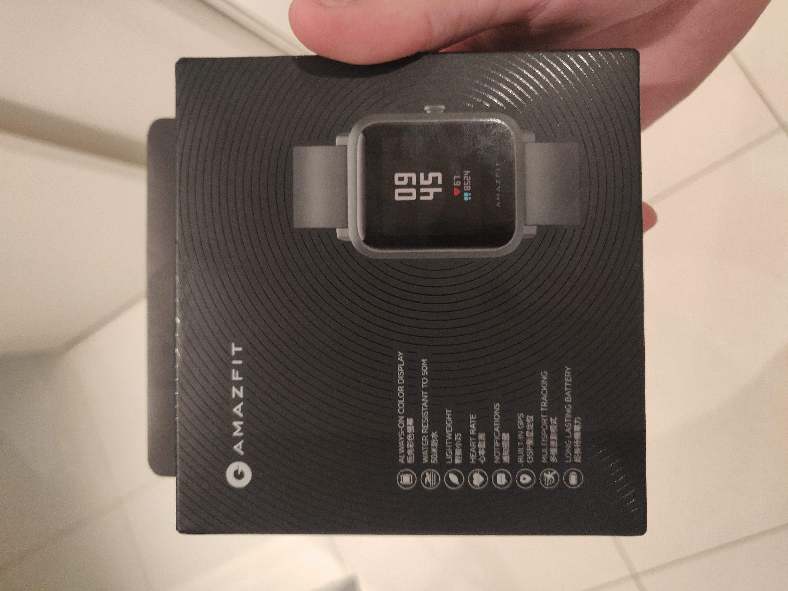
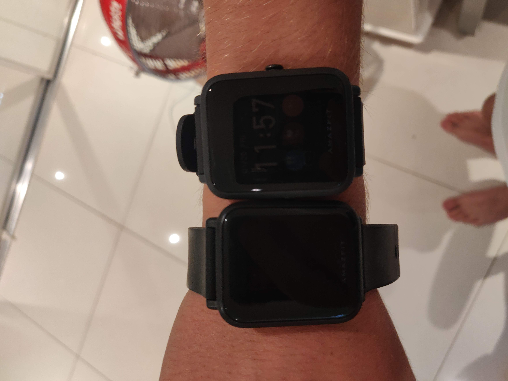
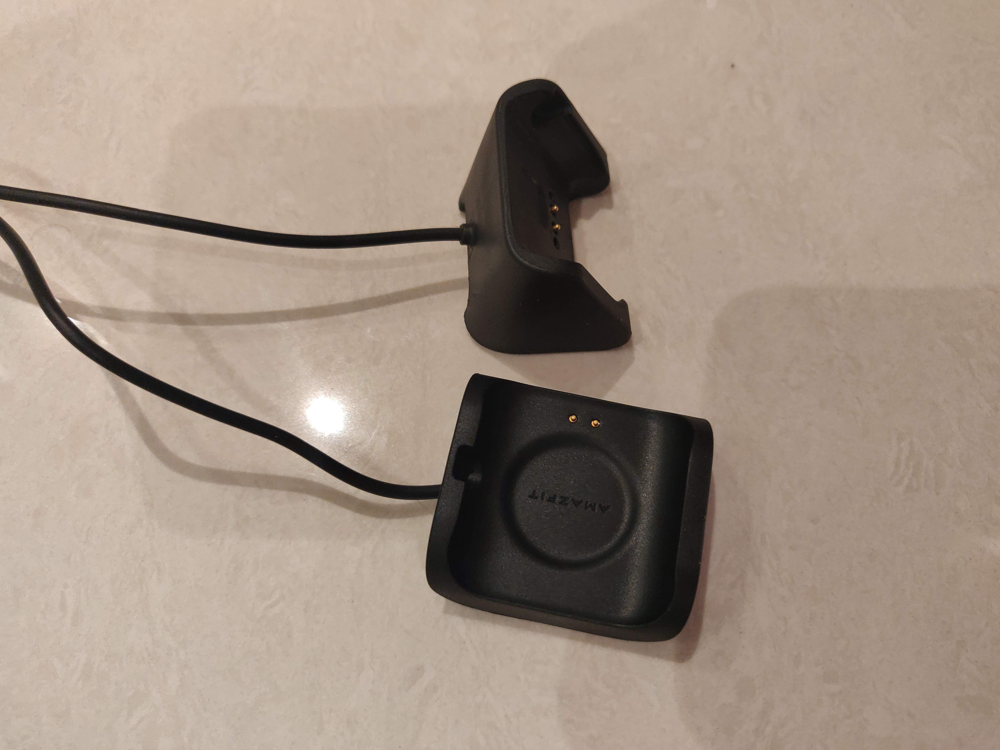
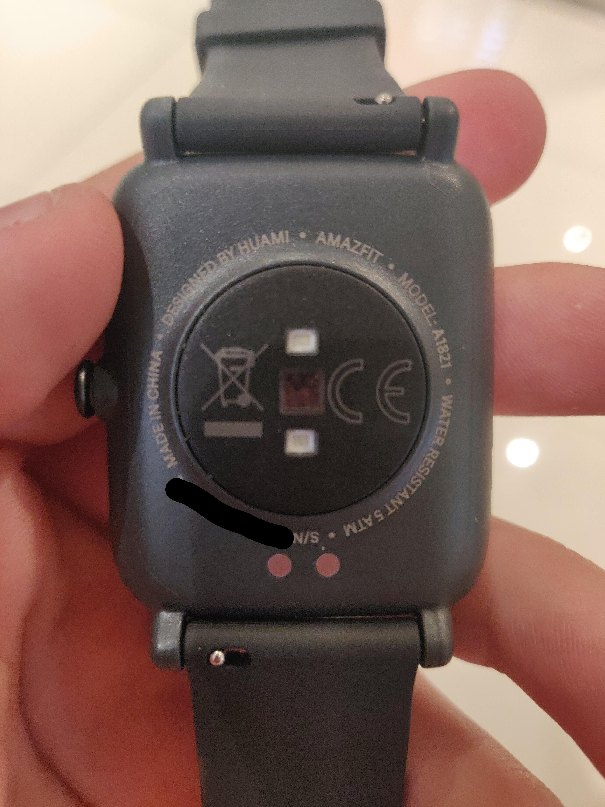

Today, my Amazfit Bip S arrived in the mail from Kogan. I ordered it for AU$101.99 around 2 weeks ago.

_Amazfit Bip S Box from the Front_

Once I opened the box up, the first thing that stood out to me was how similar it is to the original Bip.

After I put them side-by-side though, I discovered that the screens are the same size, but the plastic bezel around the edge of the glass on the Bip S is wider. Also, the glass is less rounded at the edges, hopefully making it less likely to be scratched.

_Bip (Left) vs Bip S (Right)_

This makes the watch slightly larger, but you can't tell the difference unless they are side-by-side.

Also, the Bip S uses a slightly different charger which is smaller.

_Bip S (Left) vs Bip (Right) chargers_

The charger is to accommodate the larger heart-rate sensor on the back, which also has PPG functionality.

_Heart Rate Sensor on the Bip S_

The software experience on the Bip S was surprisingly better than on the Bip. The animations are smoother, the layout of the menus is slightly different, but all-in-all it is a huge improvement. 

Once it goes on sale globally this won't be much of an issue, but at the time of writing third-party app support is minimal, if not non-existent. I was able to pair it with the Notify and Fitness app on Android, but I needed to set it up using the official Amazfit app first. Also, once it is paired, most functionality works, but some key ones don't. For example, custom watchfaces do not work, although the Amazfit app does have about ten different watchfaces to choose from.

I have only been using it for a few hours, but here are my initial findings. In a few days I hope to post an update with more information as I discover it, including testing the GPS and heart rate accuracy, as well as the swim tracking.

If you would like to see any updates I post on this watch, you can find them [here](/tags/bip-s/).

If you want to read some of my other reviews, you can find them [here](/tags/reviews/).
