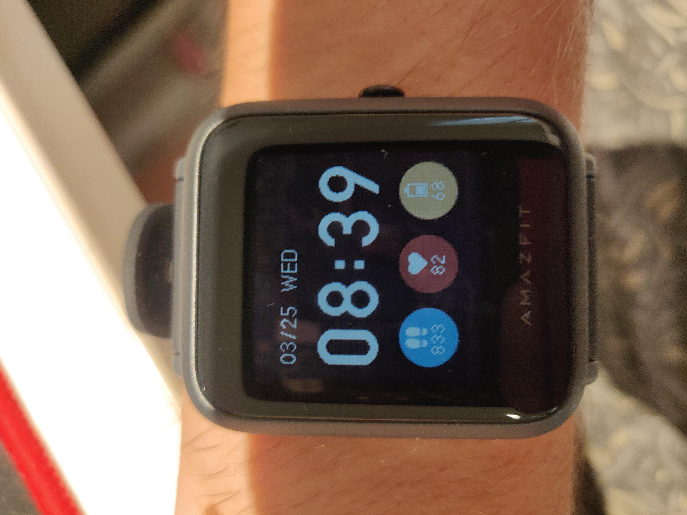
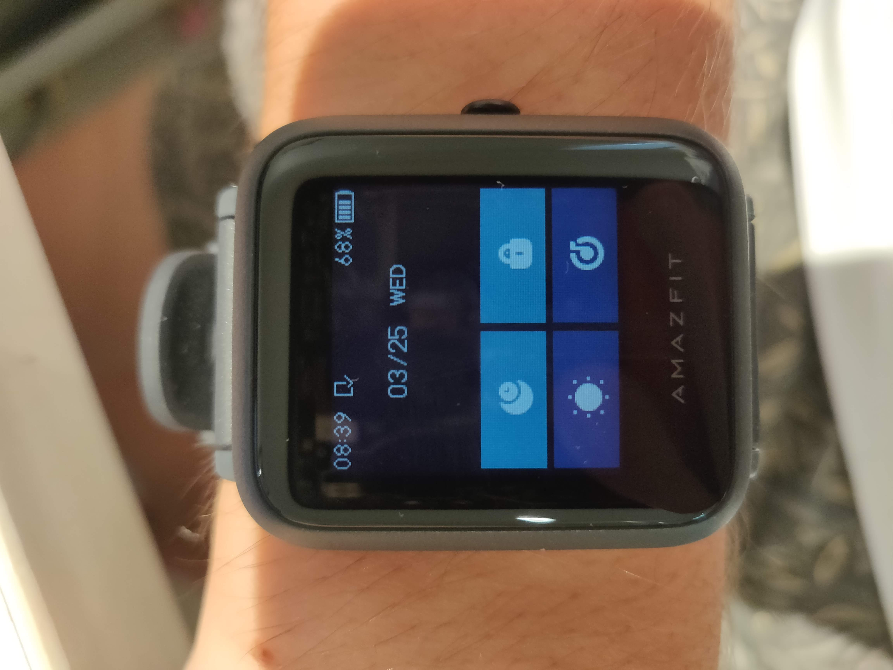
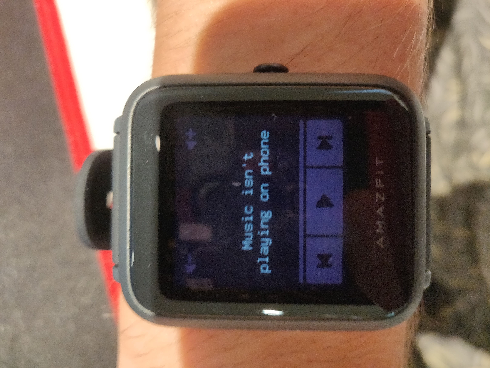

My last post was the day after I received the watch, and now that I have had a few days to play around with it, I have some more findings to share.

In this post I will be focusing on the software experience both on the watch and the app support.

## Software on the Watch

The software on the watch is majorly improved compared to the OG Bip. The first thing I noticed was how much smoother animations are when scrolling through menus. Also, the screen can show more colors, so the watchfaces 'pop' a bit more.

On the topic of watchfaces, some of the default watchfaces are customisable, so you can change what info is displayed right from the watch.

_One of the default customisable watchfaces. The circles and the date can be swapped out for other info._

There are two menus that can be accessed from the watchface. By swiping to the left or right, it scrolls through an assortment of widgets, which are rearrangeable in the official app. If you swipe up, it opens notifications just like on the Bip, and if you swipe down it opens a new control center which includes toggles for do not disturb, screen lock, brightness and a button to go to music controls.

_The control center_

If you press the button on the Bip, it opens the 'app' menu, where the sports tracking, settings, compass and other apps can be found.

You may have noticed that I mentioned music controls earlier, as there is now dedicated on screen music controls on the watch. They can be accessed through the control center or as a widget by swiping left by default.

_The music controls on the Bip S_

Other than those few things I have not found many differences between the watches. Many of the other menus have just been reskinned, as the similarities make me think the firmware version starting at v2 means it is just an improved version of the Bip's software.

## 3rd Party App Support

### The Good

The Bip S has surprisingly good 3rd party app support as of the time of writing, seeing that many developers don't even have this watch yet. I was successfully able to pair it with the popular Notify and Fitness for Amazfit app, although like the T-Rex and GTS, it requires an authentication code to function without the official app. As of the time of writing, [freemyband.com](https://freemyband.com/) has released a version of their modded app which supports the Bip S, and it works perfectly as I have now uninstalled the official app.

Another surprise was when I completed a swim and it successfully synced to my phone and to my linked Strava account as a swim.

Also, the Strava syncing of my run was the same as in the app unlike on the Bip where you needed to remove GPS data to make it accurate (at least in Notify and Fitness).

### The Bad

The experience is mostly positive, but I have found a few small issues.

As I mentioned in my last post, custom watchfaces are currently unsupported. This will hopefully change sometime in the future.

The other issue is that the menus cannot be arranged without the official app, although you can change them in the official app when you get the Auth code and then uninstall the official app and the changes will stick.

The final issue I have encountered is that sometimes the Notify and Fitness app says the watch is connected but notifications don't appear. This may be a problem with my phone, but it is hard to diagnose.

## Conclusion

If you have not yet read my initial impressions, or you would like to see any updates I post on this topic, you can find them [here](/tags/bip-s/).

If you want to read some of my other reviews, you can find them [here](/tags/reviews/).
