{: width="200" height="300" }

Since the [last time I wrote about PiHole in 2019](/posts/how-to-set-up-a-pihole-with-pivpn-and-dns-over-https/), that tutorial has accumulated over 25,000 views and is by far the most viewed post on this blog. Even to this day, that tutorial racks up hundreds of views every month, even though it is sorely out of date.

A lot has changed since 2019, including a global pandemic, and more relevant to us, the ease of configuring and installing a network wide ad-blocker. As I alluded to earlier, the old tutorial is sorely out of date, making use of OpenVPN, and DNS-over-HTTPS, both of which are much easier to configure or have been superseded since.

I realised how much easier it is now when I moved my PiHole and VPN to a VM on my new Homelab, which made me realise how sorely an update was needed.

Without further ado, here is the much simplified 2021 edition of installing PiHole and PiVPN on a your Raspberry Pi or any Debian-based Linux Distro. 

If you need instructions on how to install Raspbian, please read that section of the [old tutorial](/posts/how-to-set-up-a-pihole-with-pivpn-and-dns-over-https/) as nothing notable has changed on that front. If you are using something other than a Raspberry Pi, I recommend using [Ubuntu Server](https://ubuntu.com/download/server), although any Debian-based distribution should be able to follow this tutorial.

All screenshots are from Ubuntu Server 18.04 LTS, although it should look mostly identical on other platforms, including Raspberry Pi.

## Installing PiHole

Installing PiHole first is crucial, as it allows much of the auto configuration later to occur. 

1. Copy and paste the following command into the terminal on your system:

    ```bash
    curl -sSL https://install.pi-hole.net | bash
    ```

2. If the installer asks for a root password, provide it. 

    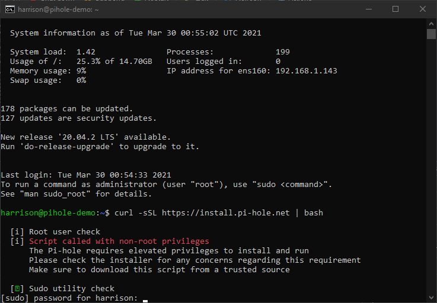

3. After clicking ENTER a few times, you should be presented with a list of Upstream DNS Providers. This doesn't matter for now if you plan to install unbound, otherwise select whichever one you prefer. This can be changed later from the Web UI. 

4. Leave the default list selected unless you prefer others.

5. Leave both IPv4 and IPv6 selected unless you know your network only uses one or the other.

6. Next you will be asked about setting a static IP. Select yes.

    

7. Make note of the warning, as you should go to your router and set it as a static IP in the DHCP server so another device doesn't get given it.
Go to your router's website to find out how for your model.

8. Select On for the web interface and web server / PHP when prompted.

9. Select On for log queries if you're not a privacy freak, and then select your level of logging you are comfortable with. This will break some charts on the Web UI if 0 is not selected.

10. Now the installer will proceed to install the Web UI and other components.

11. Once the installer finishes, now is a good time to reset the Web UI password from the default. This can be done with the following command:
    `pihole -a -p` followed by your new password twice.

12. Once this is done, you can login to the Web UI with it's IP address and use the password you just created.

13. Once there, make sure everything shows up correctly and there are no errors.

    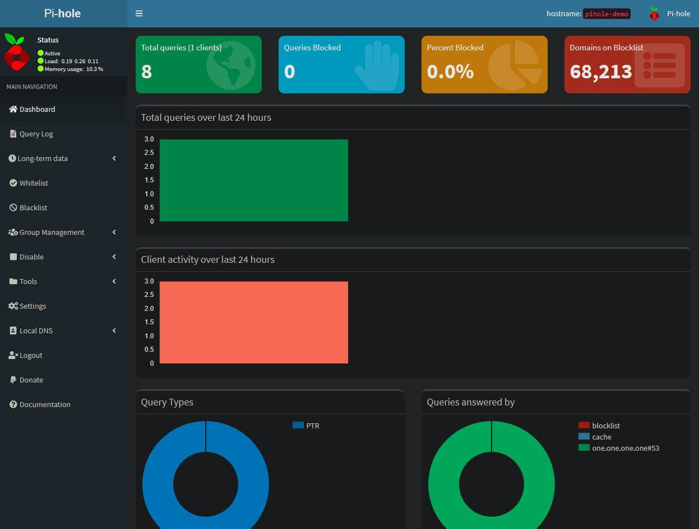

## Configuring devices to use PiHole

Now that it is setup, you need to configure your devices to use PiHole. This can be done in one of 3 ways:

1. Network-wide at the router level

2. Network-wide with the PiHole as DHCP

3. Specific devices only

They are all easy to set up, but some take longer than others. 

### 1. Network-wide at the router level

1. Open your router's web control panel. The login can usually found on a sticker on the router.

2. Go to the LAN section, then the DHCP server.

3. Find the DNS server under this, and enter the IP address of the PiHole.
    (If you haven't set a static IP, this is also likely the place to do so)

4. Click save and it should propogate to all your devices the next time they connect.

### 2. Network-wide with PiHole as DHCP

One awesome feature is that you can [set the PiHole as the DHCP server](https://discourse.pi-hole.net/t/how-do-i-use-pi-holes-built-in-dhcp-server-and-why-would-i-want-to/3026) which assigns IP addresses to devices on the network, which also solves the static IP issue.

This method takes a few more steps, but is still quite simple.

1. Open your router's web control panel. This can usually found on a sticker on the router.

2. Go to the LAN section, then the DHCP server.

3. Disable the DHCP server. Make sure it is off before proceeding.
    NOTE: This will prevent devices from easily connecting to the network. You will need to manually assign IPs **for the time being**.
    
4. Go to the PiHole Web UI and login

5. Go to Settings and then the DHCP tab.
    
    

6. Toggle the DHCP Server to ON.

7. Make sure the Gateway/Router and IP range are set correctly. If you have a simple setup, it should be correct.

8. Scroll to the bottom and click Save. 

9. Now if you connect a device to the network, it should be assigned an IP address automatically.

### 3. Specific Devices Only

This is by far the easiest to configure, but can take the longest and varies between devices.

1. Go to your network settings and find the WiFi or Ethernet connection you have.

2. However your device lets you, change **both** DNS servers to the IP Address of the PiHole.

3. Click Save.

#### Alternate Specific Device Only

One awesome feature that has been added to PiHole as part of version 5 is the ability to set different blocklists for different devices.

One way you could set devices to not use PiHole is follow method 1 or 2 and add the devices to a group that has no blocklists or vice versa. This means that on devices with no lists everything is forwarded directly to the Upstream DNS provider with no blocks.

These steps can also be used with method 3 if you want different lists for different devices.

1. Go to the PiHole Web UI and go the the Group Management section.
2. Select Groups.

    

3. Create a group for the device/s you do/don't want using PiHole's blocklists.

4. Go to the Clients section.

    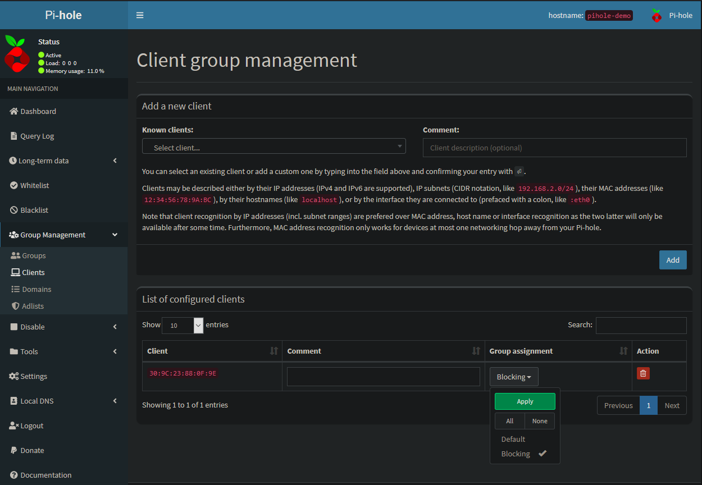

5. Select a client device from the dropdown that you want to add to the list and click Add.

6. Click on the group assignment and select the group/s you want the device to belong to.

7. These changes automatically save as you go.

8. If you want to add list specific black and whitelists, this can be done under the Domains section.

    

9. To add or remove blocklists/adlists, go to the adlists section and enter the URL to the list.

    

10. Select the group/groups you want the list to be used or not used by. 

PiHole installation is now complete! 

For more information on things you can change, like local DNS, check out the PiHole documentation at [https://docs.pi-hole.net/](https://docs.pi-hole.net/).

{: width="200" height="300" }

## Installing PiVPN

PiVPN has changed a lot since 2019. Since then, Wireguard has been released, which is a simpler, and better in every way VPN protocol. They also added auto-PiHole configuration so that profile names appear in the Web UI and you don't have to manually configure files to make it work. Also, split tunnels are much easier to configure (more on them later).

**NOTE:**If you cannot get a static IP from your ISP, or your dynamic one changes frequently, I highly recommend you looking into a Dynamic DNS service like [afraid.org](http://afraid.org)  which provides you with a URL to your IP and a script to update it to always point to the right place.
If you go this route, enter the URL created in Step 10 under the DNS Entry option.

1. Run the following command in the terminal:

    ```bash
    curl -L https://install.pivpn.io | bash
    ```

2. Enter the root password when asked.

3. Eventually a screen should appear for the Installer.

    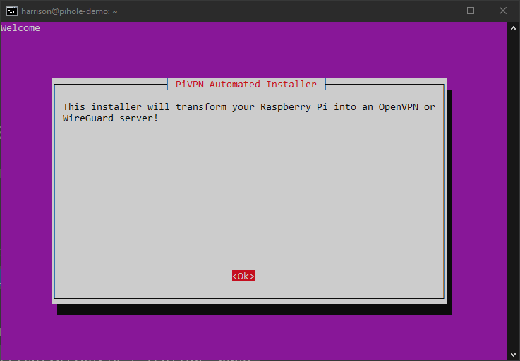

4. Next it will start setting up a Static IP.
If you are on anything other than Raspbian, it will show the following prompt, which is not a problem.

    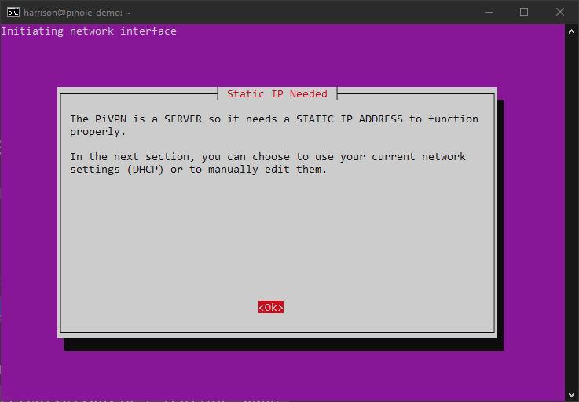

5. After that it will ask which user should hold the VPN configurations for clients. Select the default unless you've configured a separate user for this purpose.

6. Next you will be asked if you want WireGuard or OpenVPN. For this use case, I **strongly** recommend WireGuard, but if you want to stick with OpenVPN, this is where the tutorial ends and you need to look at the old tutorial.

7. After the packages are installed, it will ask for a port number. You can leave it on the default, but changing it can slightly improve security. Make sure whatever you set it to is not used by another service. Also make sure you remember what port you set for later.

8. Confirm the port is correct.

9. Next it should detect the PiHole installation and ask if you want it to be used for the VPN. Select Yes.

    

10. Next it will ask if you want to use the IP or a URL to connect to the VPN. Unless you have a URL, select the IP Address.

    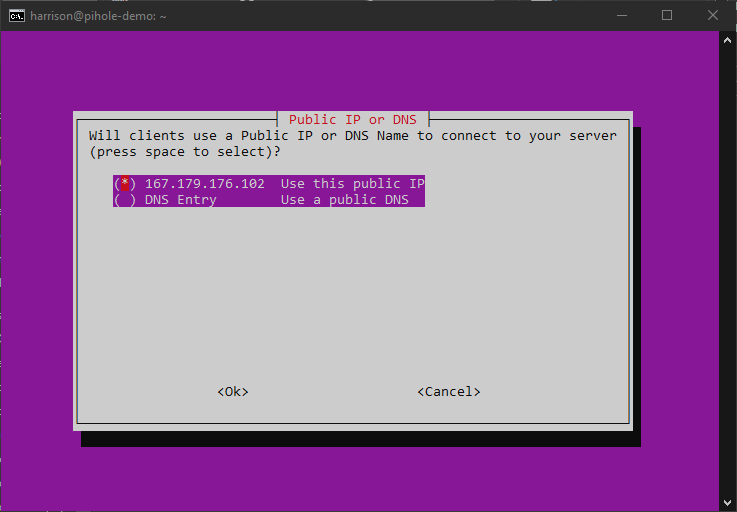

11. PiVPN will generate the Server Keys.

12. Next it will ask about unattended-upgrades. It is recommended you enable it, as otherwise your installation may be vulnerable to attacks.

13. Now the install is done, it tells you how to create profiles.

    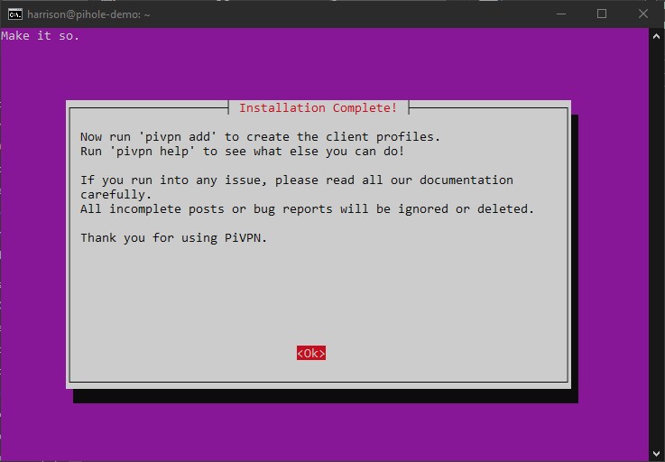

14. The server will now reboot.

    

15. Once rebooted, log back in and run the following command:

    ```bash
    pivpn -a 
    ```

16. Enter the root password if prompted.

17. Enter a client name.

    

18. Now it will show where the file is saved.

There are many ways to load the configuration onto your client device. If it is a **mobile**, you can use the handy QR Code feature to load the config file onto your device. 

To do this, simply:

1. Run the command `pivpn -qr` and enter the profile name/number when prompted.

2. Scan the QR that appears on the screen with your WireGuard app. 

**NOTE:** The QR code is based off the config file in /etc/wireguard/configs and not the one in the home directory. If you want the QR code to include config file changes, you need to change that file instead.

If you are using a **computer** or a device that cannot scan QR Codes, you will need to manually copy the configuration file to it. It is recommended to copy the version in /etc/wireguard/configs, but the one in ~/configs would work too.

### Setting up the Tunnel

There are a few different ways you can configure a VPN. One is a Full Tunnel, where everything goes through it, although it is much slower. 

The second method is a Split Tunnel, which is where only some traffic goes through it. This is optimal if you only want DNS queries going to PiHole, while everything else goes over the normal internet. This can also be used to access local IPs and therefore devices remotely.

A Full Tunnel is configured by default, but a split tunnel requires a small amount of effort to work.

These steps can be followed from either in the WireGuard program or by opening the file in a text editor.

1. Locate the line beginning with AllowedIPs, and remove everything after the `=`.

2. Now we enter the IPs/ranges of IPs we want forwarded over the VPN.

3. To make sure DNS works, Enter `10.6.0.1/24` or `10.6.0.0/24`, the second allowing access to all other devices connected over the VPN, while the first only allowing connections specifically to the PiHole.


_Specific Devices/IPs_

4. If you want to be able to access local devices, enter their IPs followed by `/24` or a range to pass through multiple, with the form `*.*.*.0` followed by `/24`. Substitute the `*` for your IP range.

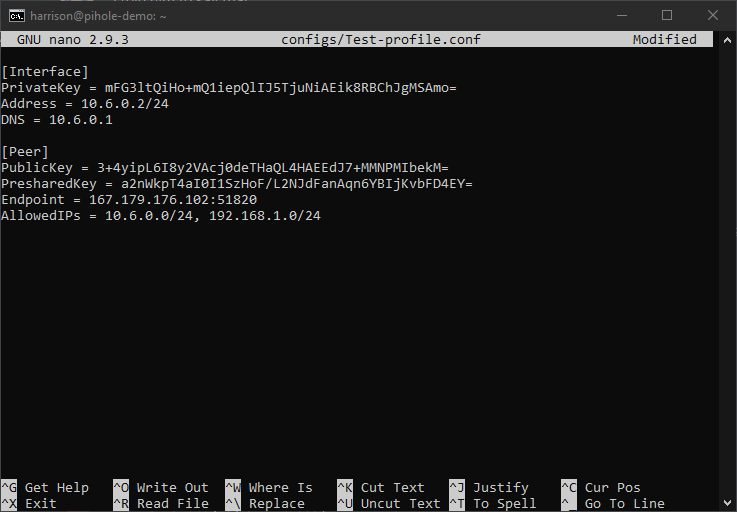
_Ranges of Devices/IPs_

5. Load the file into your VPN program and you should be good to go!

### Setting up Port Forwarding

This service requires a port to be opened to the internet, and this may not be possible in all cases depending on your ISP.

1. Go to your router's Web UI.

2. Find Port Forwarding, which is likely around a WAN section. This varies between models and manufacturers.

3. Use the port you assigned earlier as the internal and external ports and forward both TCP and UDP through it. If it asks for a internal device IP, enter the Pi's IP.

4. Click save and attempt to use your VPN.

If the VPN refuses to work, your ISP may use CG-NAT (Carrier-Grade NAT). You will need to contact them and attempt to get it disabled, which may not always be possible. **Without it disabled, Port Forwarding is not possible**.

## Installing Unbound

Unbound is a recursive, caching DNS resolver that allows for fast, secure DNS resolution with support for features like DNS-over-TLS and DNS-over-HTTPS. More info on how it works and the source of these instructions can be found [here](https://docs.pi-hole.net/guides/dns/unbound/).

### Command-line

1. Install unbound using the following command:

    ```bash
    sudo apt install unbound
    ```

    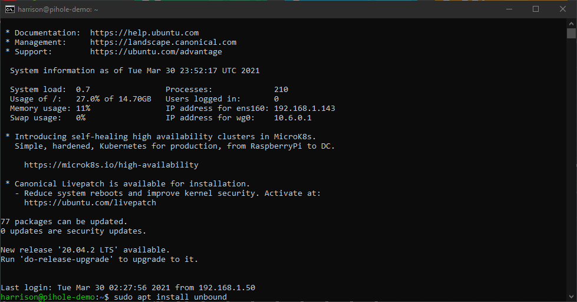

2. Enter the sudo password when asked.

3. Press Y to confirm the installation.

4. Once the install is finished, check that `dns-root-data` is installed with the command `apt show dns-root-data`. It should show info about the package.

    

    If the package is not on your platform, run the following command every 6 months:

    ```bash
    wget https://www.internic.net/domain/named.root -qO- | sudo tee /var/lib/unbound/root.hints
    ```

5. Open the configuration using the following command: 

    ```bash
    sudo nano /etc/unbound/unbound.conf.d/pi-hole.conf
    ```

6. Paste the contents of the following code block into the file:

    ```config
    server:
    # If no logfile is specified, syslog is used
    # logfile: "/var/log/unbound/unbound.log"
    verbosity: 0

    interface: 127.0.0.1
    port: 5335
    do-ip4: yes
    do-udp: yes
    do-tcp: yes

    # May be set to yes if you have IPv6 connectivity
    do-ip6: no

    # You want to leave this to no unless you have *native* IPv6. With 6to4 and
    # Terredo tunnels your web browser should favor IPv4 for the same reasons
    prefer-ip6: no

    # Use this only when you downloaded the list of primary root servers!
    # If you use the default dns-root-data package, unbound will find it automatically
    #root-hints: "/var/lib/unbound/root.hints"

    # Trust glue only if it is within the server's authority
    harden-glue: yes

    # Require DNSSEC data for trust-anchored zones, if such data is absent, the zone becomes BOGUS
    harden-dnssec-stripped: yes

    # Don't use Capitalization randomization as it known to cause DNSSEC issues sometimes
    # see https://discourse.pi-hole.net/t/unbound-stubby-or-dnscrypt-proxy/9378 for further details
    use-caps-for-id: no

    # Reduce EDNS reassembly buffer size.
    # Suggested by the unbound man page to reduce fragmentation reassembly problems
    edns-buffer-size: 1472

    # Perform prefetching of close to expired message cache entries
    # This only applies to domains that have been frequently queried
    prefetch: yes

    # One thread should be sufficient, can be increased on beefy machines. In reality for most users running on small networks or on a single machine, it should be unnecessary to seek performance enhancement by increasing num-threads above 1.
    num-threads: 1

    # Ensure kernel buffer is large enough to not lose messages in traffic spikes
    so-rcvbuf: 1m

    # Ensure privacy of local IP ranges
    private-address: 192.168.0.0/16
    private-address: 169.254.0.0/16
    private-address: 172.16.0.0/12
    private-address: 10.0.0.0/8
    private-address: fd00::/8
    private-address: fe80::/10
    ```

    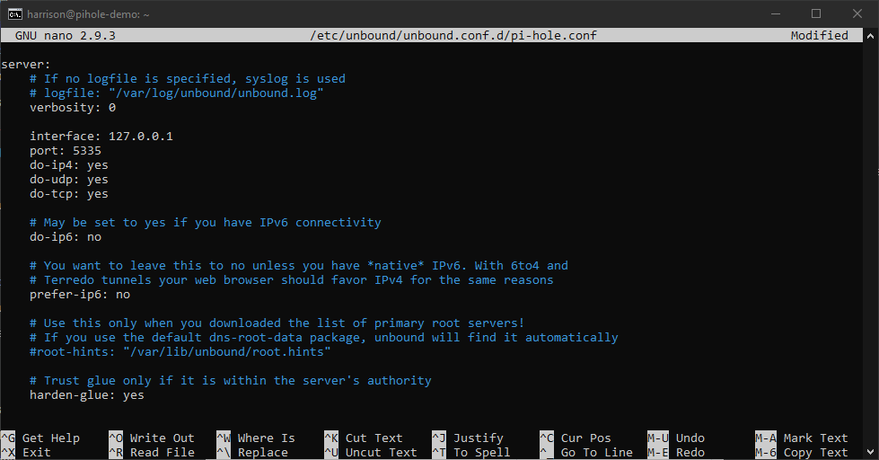

7. Close and save the file.

8. Restart unbound to apply changes:

    ```bash
    sudo service unbound restart
    ```

9. You can test if it is working using the following command:

    ```bash
    dig pi-hole.net @127.0.0.1 -p 5335 
    ```

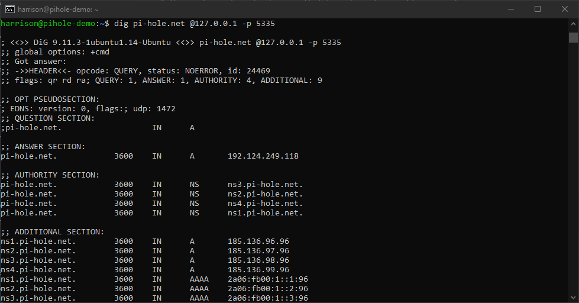

### PiHole Web UI

1. Go to the Settings section, then the DNS tab.

2. Untick all of the DNS Servers in the left columns.

3. Tick the Custom 1 Server and enter the following IP: `127.0.0.1#5335`

    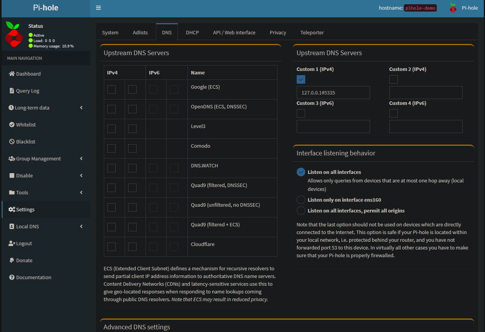

4. Scroll to the bottom and click Save.

**OPTIONAL**: You can enable DNSSEC to validate that DNS queries are legitimate, but it is not required.

## Conclusion

I hope that this tutorial is useful and easy to follow, and of course if you have any feedback or have a problem, please leave a comment or contact me on Facebook.

As I think this is the right group of people to ask, if anyone knows of a way to monetise this site without using intrusive ads, please send me an email at [contact@crankshafttech.com](<mailto:contact@crankshafttech.com)>)with your suggestions.

If you liked this tutorial, you can find all my other tutorials [here](/tags/tutorials/), and also through the tags below.

more

Update #1: Added Port Forwarding to PiVPN setup. Thanks u/blast-inc for pointing it out!

Update #2: Added a note about Dynamic DNS for non-static IP Addresses. Thanks u/FlashDerPlatte for making me aware!

Update #3: Added instructions for generating the QR Code for mobile VPN clients, and for investigating what file it is generated from. Thanks u/ThisUserEatingBEANS for reminding me of this amazing feature!
