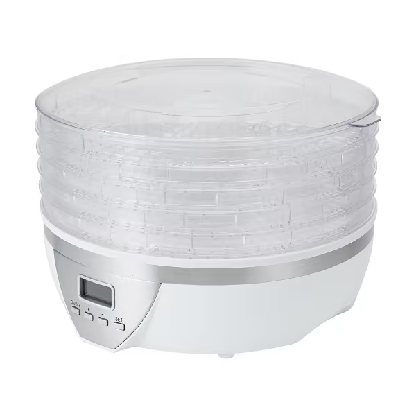

Since I got my first 3D Printer for Christmas in 2017, I have acquired quite a few rolls of filaments for different brands, types and sizes. With their varying ages and qualities, I was bound to have issues eventually.

Here in Australia, especially further north, the climate is extremely humid and unforgiving, and is probably not ideal for 3D Printing.
What ends up happening is that the filaments absorb moisture and become waterlogged, leading to popping, rough extrusion, lack of adhesion and, in the most extreme cases, failed prints.

Recently, while attempting to use my 1kg roll of Black PLA, the prints were failing to adhere to the bed, while popping noises could also be heard from the nozzle as the moisture boiled off. To solve this, I knew I needed a way to remove the moisture of the filament without ruining the spool, if it was even possible.

Turns out, it is!

The most commonly recommended and widely accessible method is to use an oven, but with PLA's [glass transition temperature](https://www.sciencedirect.com/topics/materials-science/glass-transition-temperature) of 70°C, this requires an oven that can reliably and stably be set to between 40°C-50°C, which is not possible for many, including mine.

I also went looking for a small-tabletop oven that would have lower temperatures, but frustratingly most did not have true temperature settings and opted for "Hot" and "Warm" instead, further complicating my research. Sadly I was unable to find one that would go to a low enough temperature (Most were around 90℃) unless I was spending more than I was willing to.

The final option, that I ended up working with, is a food dehydrator. These are designed to operate for long periods of time at the temperatures required, but instead of drying fruit it's drying plastic.
The one I decided upon was the [$45 Anko Food Dehydrator from Kmart (Australia)](https://www.kmart.com.au/product/food-dehydrator/3419823), although any dehydrator that has temperature controls within the required range would work.

One other thing to check is that your spools will fit, although if there are trays in the way like there was for me, they can be easily removed.

_The dehydrator used in this post_

The first thing to do once you purchase the dehydrator is test everything works, because after it is modified it will not be possible to return it.

Now that it is confirmed working, the trays need to be removed. This will require only one tool, being the side-cutters, such as the ones that came with your printer.

Note that this can be a little messy, depending on how brittle the plastic is, so I recommend doing this in a place that can easily be cleaned or somewhere where mess doesn't matter.

Finally, ***FOR SAFETY***, wear safety glasses to prevent plastic from entering and damaging your eyes, possibly permanently.
It is for this reason that I hold **NO** liability for any damage or injury sustained from following this post under any circumstances.

To make the filament rolls fit in the dehydrator, it is quite a simple process.

1. Use the cutters to go around the inside edge of the tray and cut off the inside grid from the outside wall. In my case, I only needed to cut until I heard a crack and not all the way through. Also, not twisting while cutting significantly reduced the mess and flying plastic.
1. Push the middle of the tray until it separates from the walls.
1. Repeat for the remaining trays, although in my particular model the roll sat nice on the bottom tray, so I left that intact.

{: width="400" height="300" }
_The dehydrator with most of the racks cut out_

Now that the modifications are complete, it is time to get drying!

## Is It Worth It?

To test whether or not it is worth the money and effort, I tested with my Black 1kg PLA roll that was failing to print, and it was compared to a roll bought at the same time of the same type and supplier but of a different colour, being transparent green.

To measure whether it had been improved or not, I checked:

- How much popping there is, which would indicate moisture
- The consistency of the flow from the nozzle
- The smoothness of the walls of the print, as bubbles would cause the print to become rough
- If the print actually finishes successfully

The prints were completed on an Ender 5 with a BL-Touch, with everything else stock.

The models used were the ["Cute Mini Octopus"](https://www.mcgybeer.xyz/main/cute-mini-octopus) and the [3DBenchie](https://www.thingiverse.com/thing:763622). Once I successfully got one material to print, I used the exact same settings and gcode to print the next one.

{: width="400" height="300" }
_Black and Green Octopi_

Both turned out great once all the settings were dialled in, but the black dried filament had slightly less stringing, which is commonly attributed to moisture. Also, no popping was noticeable which means there was no evaporating moisture affecting the flow rate. Both prints were smooth and did not have any obvious under-extrusion or flow issues.

{: width="400" height="300" }
_Black and Green Benchies_

Interestingly, with the 3DBenchie, there was more noticeable stringing on the black than the green, but otherwise they both turned out great. They both completed and all features were present.

## Conclusion

Other than the Benchies, there isn't really much evidence against this method, although it is far from scientific. Maybe in the future I will have to do a deeper dive into environment variables such as temperature and humidity, as well as other factors. If I had more time, I could make this a lot more reliable through multiple prints with each material of the same models and accurately controlling the environment, and not just with the air-conditioning.

The main flaw with my experiment was that I did not have a working print to compare to with the same roll from before drying, so I may revisit this in the future when the problem arises again.
But for now, I will continue to dry my filaments to ensure the flow rate is consistent and that there is no dilation of filament, but I would not consider it a must, at least for PLA.

As always, if you liked this post, you can find all my other 3D Printing content [here](/tags/3d-printing/), and also through the tags below or in the sidebar.

If you have any feedback or thoughts, please leave it in the comments below,  and thanks again for reading!
