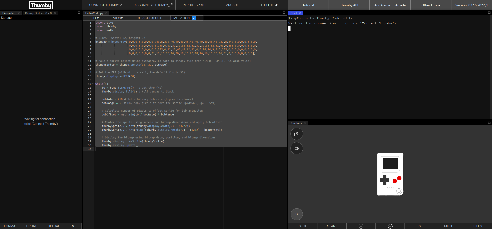

Kickstarter projects have not failed to impress over the years. Every since I first backed the [Circuitmess MAKERphone](https://circuitmess.com/products/ringo-diy-cell-phone) in 2019, I have always found it incredible how many kinds of products people have been able to produce through the platform. And while some of these do take longer than expected to arrive (looking at you, [Flipper Zero](https://flipperzero.one/)), when they do, I have always been blown away.

The Thumby is no exception.

Created by the team at [TinyCircuits](https://tinycircuits.com/), this is not their first foray into tiny electronics. In fact, I'd say the Thumby is a culmination of all their previous work, taking the TinyArcade, TinyTV, and all their tiny electronics knowledge and making it into this incredibly tiny keychain game console.

When it arrived, I was shocked at how small the box was. It was smaller than I thought the device would be, and the device inside was even smaller! With the device being just 29.5mm x 18mm x 8.5mm in size and only weighing only 4.7g, it is so insanely small, it's hard to convey it through photos.

_Thumby next to a USB stick_

The version I received is the special clear edition, with most units being a grey Game Boy colour scheme. The benefits of the clear case including seeing how small the components inside are (there's a battery in there!), as well as it just looking absolutely cool. I hope more companies bring back clear acrylic cases, because they still look awesome.

_The PCB Commemorative Keychain that also came with the Thumby_

As it is a game console, it is able to run a variety of games utilising it's tiny D-Pad and A/B buttons, which require fingernails to actually press reliably. On the Monochrome OLED, animations are smooth in menus with it's 60FPS refresh rate and games such as Saur Run (Chrome Dinosaur Game clone) are crazy clear, even during fast side-scrolling motion. The OLED is also surprisingly crisp for it's size, with the screen being 72x40 pixels. With this screen size, because of how few pixels there are, text takes up a large section of the screen if it is meant to be readable, which limits overlays and other text-based game features.
The Thumby also somehow fits a tiny buzzer inside, so old "beeps" and "boops" are possible, although because of it's size it is extremely quiet.
The final cool feature of the Thumby's gameplay is that is supports multiplayer over their custom Micro-USB to Micro-USB link cables, allowing for competitive Tennis as well as other games in the future.

For me personally, the coolest aspect of this console is not that you can play games, but you can easily make more yourself. As the Thumby is based on the RP2040 processor found in the Raspberry Pi Pico, it supports programming in multiple languages including Python and C, although the officially supported programming method is through the browser, and allows for programming in MicroPython without any additional software. Sadly, WebSerial is only available in Chrome and Edge, so Safari and Firefox users are out of luck, although the included emulator can still be used in these browsers, as well as for people who don't have a physical Thumby.

_The Thumby Code Web Editor, with it's built-in emulator_

If you are willing to tinker and want a more fully-featured IDE, this [guide](https://dev.to/blues/your-first-steps-with-raspberry-pi-pico-and-visual-studio-code-4jbd) on using Visual Studio Code is also available, although I could not get it to work on my Linux installation. For a more basic offline IDE, [Thonny](https://thonny.org/) is also available, and is the easiest way to code without a browser.

So who is the Thumby for? It is for people who want to have a cool, working Game Boy clone on their keys or lanyard, but also people who want a fun little project for making games and other little programs on this fully featured console.

Starting at US$19 on their [Indiegogo Campaign](https://www.indiegogo.com/projects/thumby-the-tiny-playable-keychain#/), this is a must have for any tech enthusiast or gamer who wants a console on them everywhere they go, but also have a portable, easy-to-use development platform to fulfill their game design goals.

As always, if you liked this review, you can find more [here](/tags/reviews/), and also through the tags below or in the sidebar.
If you have any feedback or things that I should change in future reviews and showcases, please leave it in the comments below, and thanks again for reading!
