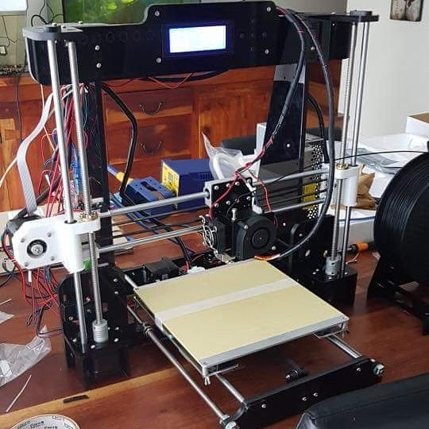

I still remember the Christmas morning of 2017, when I opened the gift from my parents to find an Anet A8 3D Printer kit. Before this moment, I never even considered being able to afford this futuristic technology, let alone actually owning one. But my parents knew my love for technology well, and timed this gift just perfectly with the rapid growth in the 3D Printing space.

_The Anet A8 after it's first power-on test._

### Anet A8 First Impressions

When I first assembled it, I had no idea how to use a 3D Printer, let alone how they work. But having such a bare-bones kit allowed for me to learn through using it all the tips and tricks from fixing the numerous issues to improving print quality. If I had gotten a Prusa i3 instead, I feel I would have missed out on much of the knowledge I gained.

### What's Changed with Newer Printers?

While most 3D Printers now have magnetic or glass beds, the A8 used painters tape, which was great when I was first learning and regularly did a terrible job at levelling the bed, but quickly became obsolete due to the rough texture it left on the bottom of prints. The amazing thing about this bed was that it was heated, which was not a feature all printers possessed at the time. This allowed for much better prints as bed adhesion could be greatly improved without using large brims and glue sticks.

While this was all great, the main improvements that newer printers now feature are greatly improved safety. The Anet A8 was notorious for setting itself alight, be it from the horrible hotbed connector that would break off and short, or the power supply that I personally had to replace after it started sparking. The stories I heard about this printer have still made me paranoid to this day about having my Ender 5 print overnight or when I'm not at home, which makes long prints impossible.

### Enter the Ender 3 & 5

Towards the end of 2019 and into 2020, the Ender 5 and it's smaller sibling the Ender 3 were the new recommendations over the Anet A8, with the Ender 3 becoming the new most popular printer. The key improvements with these printers were all metal frames, which the A8's acrylic frame could not compete with, as well as increased reliability and print quality. While the Ender 3 is a direct competitor to the A8 with it's "T" shape, the Ender 5 is a "Box" printer with a square frame, which adds further rigidity, but also bulk. Comparing the Print QualityAround Easter in 2018, 4 months after I first assembled the A8, I downloaded [Easter Egg models off Thingiverse](https://www.thingiverse.com/thing:2829553) and printed one of them to celebrate the event. Now, 4 years later, I sliced the same file for the Ender 5 and printed it again to compare the quality. 

_Ender 5 (Left), and Anet A8 (Right)_

Sadly, the Anet A8 version was scaled at the time, and as it has been significantly upgraded and then decommissioned, I am unable to create a full size version. Although, in light of this, the main issue with the Anet A8 can still be seen, being the lacking in resolution. Firstly, the A8 used a 0.4mm nozzle compared the to 0.2mm on the Ender 5, but this is not the main culprit. The acrylic frame of the A8 allowed for the nozzle to flex it during fast movements, leading to the "fuzzy" effect that can be seen. As the Ender 5 has a metal frame, this is absent on it's model.
Secondly, the Anet A8 featured a direct-drive extruder, which means the extruder motor and nozzle are both on the carriage which is moving around quickly. This means that there is more weight on the carriage, leading to slower acceleration and deceleration, as well as extra inertia leading to the print-head moving further than it should before recoiling. While many printers, such as the Ender 3 S1, still use a direct-drive extruder, the Ender 5 uses a bowden extruder, which has the extruder motor attached to the frame with a tube running to the extruder on the carriage, allowing for the carriage to move quicker due to the reduced weight, although the belts still produce a small amount of recoil, but it is significantly lower than it was in the past.  What about more recently and in the future?The Ender 5 is definitely not the cutting edge of printers, having been released in 2019. Printers from companies such as Artillery, Anycubic and Elegoo are taking the market by storm, and future machines such as the AnkerMake M5 may be the biggest innovation in the space in years. So while printers are already amazing, the move now is to make it easier to achieve the same results. In regards to quality, there are also resin printers available now with insanely high resolutions, making it possible to make highly detailed models and small parts that were previously impossible with FDM printers.
A Final Easter TreatSince I had the printer already running, I decided to print a set of rabbits to test the overhangs, but also to celebrate the holiday. Making use of the awesome translucent green PLA I bought, I was able to print 2 rabbits with one using the normal Cura supports, and the other tree supports.

_Normal Supports (Left) vs Tree Supports (Right)_

First up, the normal supports was printed using the touching buildplate setting to make it more comparable to tree supports. The print took 5hrs, 49mins and 27secs. Shortly into the print, the support for the hand collapsed, meaning the bottom of the left hand did not complete, although thankfully the print saved itself and completed everything else successfully. Next up, the tree supports model took 6hrs, 30mins and 32secs, which is ~40mins longer than the normal supports, probably due to it using slightly more travel. The benefit of tree supports was on full show, with the model using less material but also supporting the entire overhang instead of just the part that's directly over the bed, as the "branches" bend and insert themselves between the gaps in the model, as well as wrap themselves around the model for minimum filament use. They are also hollow, meaning they are super easy to remove and, once again, use less material than the solid normal supports. In regards to removing the supports, both took a similar amount of time to remove, with most of the time spent removing the internal supports, as they were both quite secured to the inside of the head, which was too deep for the side-cutters. Conclusion
As always, if you liked this post, you can find all my other 3D Printing content [here](https://blog.crankshafttech.com/search/label/3D%20Printing), and also through the tags below or in the sidebar. If you have any feedback or thoughts, please leave it in the comments below, and thanks again for reading!
