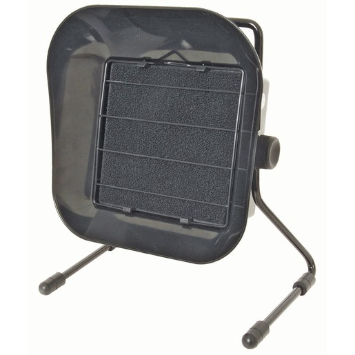
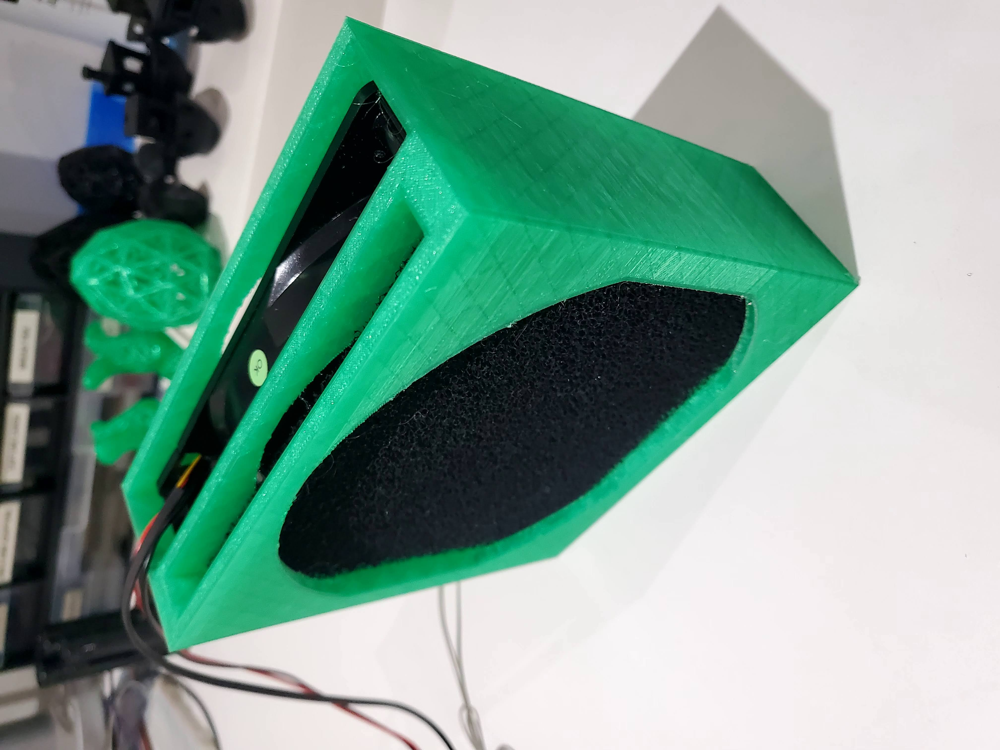

Ever since I started soldering, I knew that ventilation was key. Especially when working with leaded solder, the fumes can be extremely harmful, and being able to vent, or in the case of this post, capture the fumes, can greatly decrease the health risks associated.

The goal of this project was simple. Design a simple holder for a carbon filter and standard 12V PC case fan for less than what I could buy.

I started by investigating what was already available on the market, only to find that all the options were quite expensive, at over AU$50, but not of the quality I would accept for that price.

_A fume extractor that costs AU$75_

From these findings, I set out to make my own version, and while I have not fully completed this model, I have made the most key part to get a prototype working.

The design consists of 2 parts: the main assembly, and the lid/mount combo. The main assembly consists of 2 slots that fit a 140mm PC fan, and a carbon filter. The fan I am using is from an old PC I picked up a few years ago, and features a molex power connector and a 3-speed switch as a bonus, while the carbon filter was purchased off eBay as a 4-pack for under AU$7.

Factoring in that a cheap 140mm fan can be bought off eBay for AU$12 and a few dollars in time and materials for the 3D-Printed components, this design comes in significantly cheaper than a store-bought alternative.

_The main assembly with a fan and filter installed_

The final part that I am yet to design is the lid/mount, which will lock all the components inside so they cannot fall out, as well as allow the model to be attached to a stand or arm for optimal positioning through the planned use of a threaded insert, which I hope to attempt installing using the soldering-iron method, which melts it into place.
Also, the lid will allow for the installation of the barrel connector, which will replace the molex power connector so the fan can easily be plugged in to an external 12V power supply.

While this is definitely one of the simpler projects I have worked on, having it so simple has allowed me to actually (mostly) complete it, unlike many of my other projects, especially while I juggle these projects, school and work.

To make one for yourself, the model can be accessed at [Thangs](https://social.thangs.com/m/75397) and at [Printables](https://www.printables.com/model/218083-140mm-pc-fan-carbon-filter-fume-extractor).

While this was a little late, my June post will be out soon, reviewing the incredible Flipper Zero! To get notified when the post drops, sign up for email notifications in the sidebar, as well as follow the socials @crankshafttech on [Facebook](https://www.facebook.com/crankshafttech/) and [Instagram](https://www.instagram.com/crankshafttech/).

As always, if you liked this post, you can find all my other 3D Printing content [here](/tags/3d-printing/), and also through the tags below or in the sidebar. Also, please consider donating via [GitHub](https://github.com/sponsors/hasmar04) or [PayPal](https://paypal.me/harryasmar) so I can continue making content into the future.

If you have any feedback or thoughts, please leave it in the comments below, and thanks again for reading!
