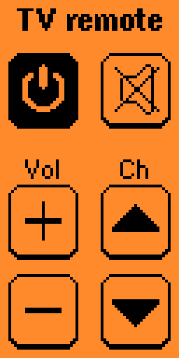
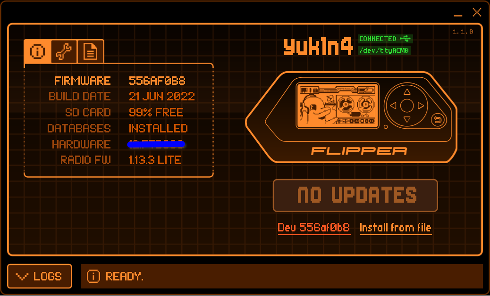
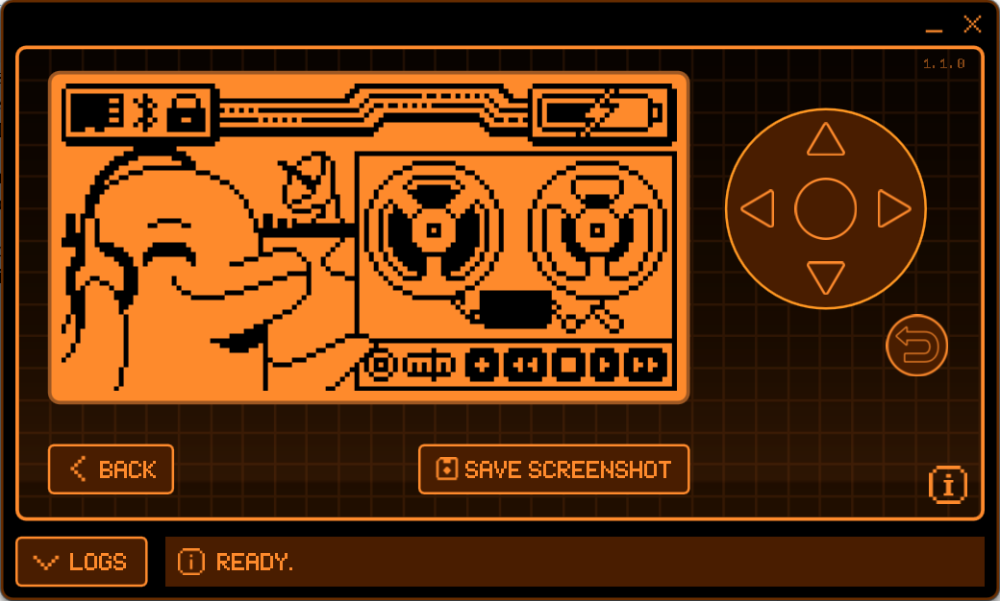
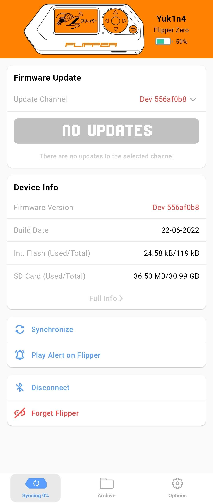

I placed my Kickstarter pledge for the Flipper Zero all the way back in August 2020, and at the time it was estimated that they would be delivered in February 2021. But with COVID-19 lockdowns and supply chain issues, this timeline was quickly revised.

Finally, in May 2022, I received my device. But was it worth the wait?

_Flipper Zero in it's box, accompanied by a cute sticker!_

## What Does It Do?

The Flipper Zero was promoted in the campaign as a "hackers multitool", allowing for the capture and retransmission of various signals and protocols. For instance, I've used mine to save TV and air conditioning infrared remotes, and my NFC ID cards. Various sub-GHz radio frequencies can even be saved, such as car keys, garage openers, and in my case, a light remote. Note that the available frequencies do depend on your region if using the official firmware.

Some of the other awesome features include it being able to function as a U2F security key, a Bad USB with duckyscript support, and UART bridge from the GPIO to a PC.

## Hardware

Since the hardware is the only part of the device that I would consider final, I will start there.

The device is surprisingly heavy for it's size, due to the number of components crammed inside. It is also quite thick, which is actually nice, as it allows for the device to be grasped easier within the hand.

_Flipper Zero without it's protective case._

The case is plastic, the buttons are also plastic and the screen is acrylic. While this does make sense for the price and the type of device, it does mean the screen scratches easily, so don't put it in your pocket with your keys. I hope screen protectors become available at some point, but as of writing you need to cut your own.

As part of the Kickstarter campaign, both black and white versions were available, but only white will be available when they eventually can be purchased directly.  I bought the black version as it is less likely to discolour over time, but it is also for the exclusivity. Regardless, black looks epic.

As for the visible hardware features of the device, there is a USB-C and wrist-strap hole on the right hand side, a micro-SD card slot on the bottom, and the iButton pogo-pins on the back-left, below the infrared blaster/receiver on the end. Finally, on top are the GPIO pins, and on the front are the monochrome LCD display and six button d-pad.

Inside, there are antennae for Bluetooth/Zigbee, Sub-GHz, 125 kHz RFID and NFC.
Note that while Zigbee is supported by the device, it requires Bluetooth be disabled through a firmware flash, so both cannot be used simultaneously.

## Software

While the firmware is far from complete, much of the core functionality is already available.

For instance, the USB-C port is used to charge and flash firmware onto the device, although they are currently perfecting a way to [update from their mobile app via Bluetooth](https://blog.flipperzero.one/new-firmware-update-system/). This port is also used for the U2F security key functionality, as well as the Bad USB, which supports Duckyscript.

The micro-SD card slot is used to store all of the important files that
 do not fit within the tiny built-in flash. This includes saved signals,
 firmware updates and any other large files for use with the various
apps and plugins.

On the left, the
iButton pogo pins can be found. While I have never personally seen these
 before, they are said to be common in many parts of the world, and
allow for simple authentication and access to buildings and systems.

Right above the iButton pins, the Infrared blaster/receiver can be found. This is what is used for saving and re-transmitting buttons from remotes for all sorts of devices, from TV remotes to air-conditioning units. It is also used for the universal remote functionality, which sprays numerous different codes, one after the other, until the target device receives a code it understands. Currently this is only available for TVs, but in future has the ability to support many more device types.

_The Universal Remote interface, which makes use of screen rotation._

In terms of firmware updates, currently custom firmwares (which there are already many of) can only be flashed through qFlipper on the desktop and not the mobile app, although this should be something that is improved upon in the future.

Speaking of qFlipper, this simple tool allows for the installation of firmware, as well as managing files on the devices storage, including the SD card.

_The qFlipper interface._

The other awesome feature it includes is being able to stream the screen and control the device from the program, allowing for easy screenshot capture through the built-in button.

_The qFlipper remote control interface._

Sadly, the mobile app is missing many of these features. For instance, it is possible to upload files onto the flipper, but there is no ability to create new files or delete files that are not identified as being for one of the functions. For instance, some configuration files for custom firmwares.

_The Flipper Zero mobile app on Android._

While the app is missing many features, it also has a few that are unique. For instance, keys can be deleted and restored through the Archive tab, and favourites can be assigned, which also show up on the Flipper desktop.
Also, emulation can be triggered, and files can be modified and renamed without having to deal with a d-pad keyboard.
Finally, files can be shared via a special link, allowing files to easily be shared with other users.

The app is available to download on both the [Google Play Store](https://play.google.com/store/apps/details?id=com.flipperdevices.app) and [Apple App Store](https://apps.apple.com/ec/app/flipper-mobile-app/id1534655259).

## The Future

While the hardware is definitely complete, there are still many features of the firmware that were promised as part of the campaign but have not yet been implemented.

For instance, Flipper Zero's are meant to be like a dolphin Tamagotchi, with the ability to look after it and level up. Currently, the levels are partially implemented, but the mood does not change and there are no ways to actually care for it. The animations are currently just randomised.

Also, Flipper Zeros are meant to be able to communicate with others over the 433MHz frequency and become friends, but this is nowhere to be seen, although I do understand that this would take time to implement and is probably not the highest priority.

Another thing which was promised, and I believe is the most crucial missing feature, is plugins. Currently, they do exist, but they need to be compiled as part of the firmware, which is more effort than most users are willing to put in. As part of the campaign, it was said they would be able to be installed without firmware updates, and would also support Arduino files. This will open up a wide range of possibilities, such as being able to quickly and easily start using modules via the GPIO, as well as use the internal features in new and exciting ways.

Along with the things mentioned above, there are many features that people have been asking for, which were neither promised or implemented as of time of publishing. These include additions of extra radio protocols, such as to decrypt different types of garage openers and swipe cards. While it would be cool to see these implemented, it is probably not their highest priority, and the community is already helping them out.

## Conclusion

In conclusion, the Flipper Zero was definitely worth the wait. Even though it took almost 2 years to arrive, it is just as awesome as I imagined, especially since there is nothing else like it.  It allows for so many IT tasks to be completed in a quicker, simpler way. And with the future addition of proper plugins, anything is possible. As new features and improvements are added, I hope to create more content on this amazing device in the future.

If you are interested in getting one for yourself, they will eventually be available from the [Flipper Shop](https://shop.flipperzero.one/) for US$169 (not affiliated).

If you already have one for yourself, or are just interested in the software side of things, the firmware GitHub repository can be accessed [here](https://github.com/flipperdevices/flipperzero-firmware).

As always, if you liked this post, you can find all my other hands-on content [here](/tags/hands-on), as well as through the tags below or in the sidebar.
Also, please consider donating via [GitHub Sponsors](https://github.com/sponsors/hasmar04) or [PayPal](https://paypal.me/harryasmar) so I can continue making content into the future.
Finally, to get notified when new posts drop, sign up for email notifications in
the sidebar, as well as follow @crankshafttech on [Facebook](https://www.facebook.com/crankshafttech/) and [Instagram](https://www.instagram.com/crankshafttech/).

If you have any feedback or thoughts, such as anything you would like to see done with the Flipper Zero, please leave it in the comments below.

Thanks again for reading!
