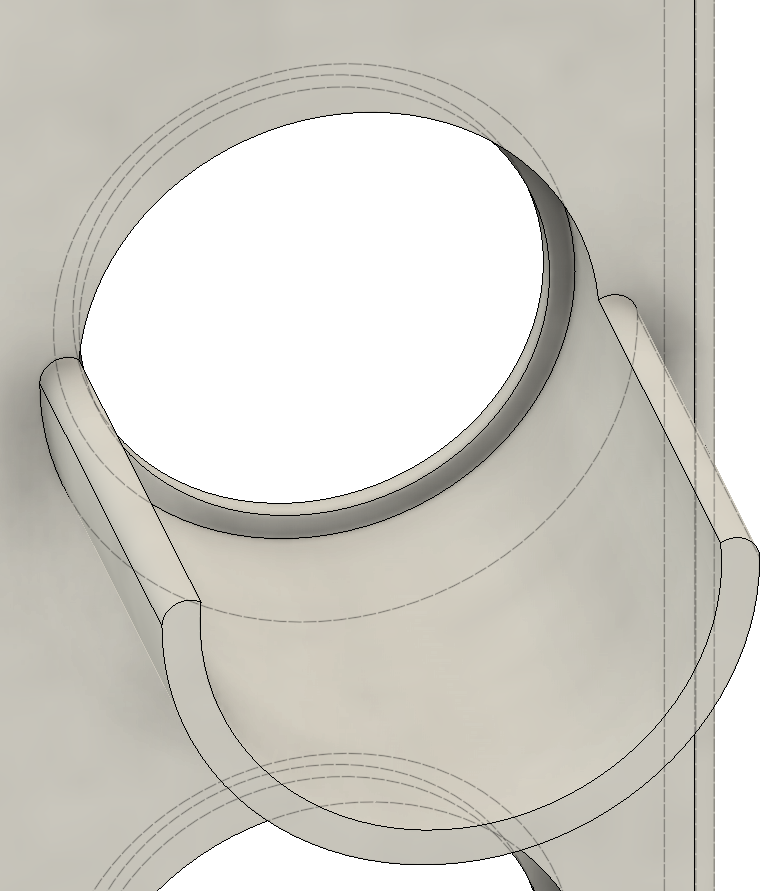
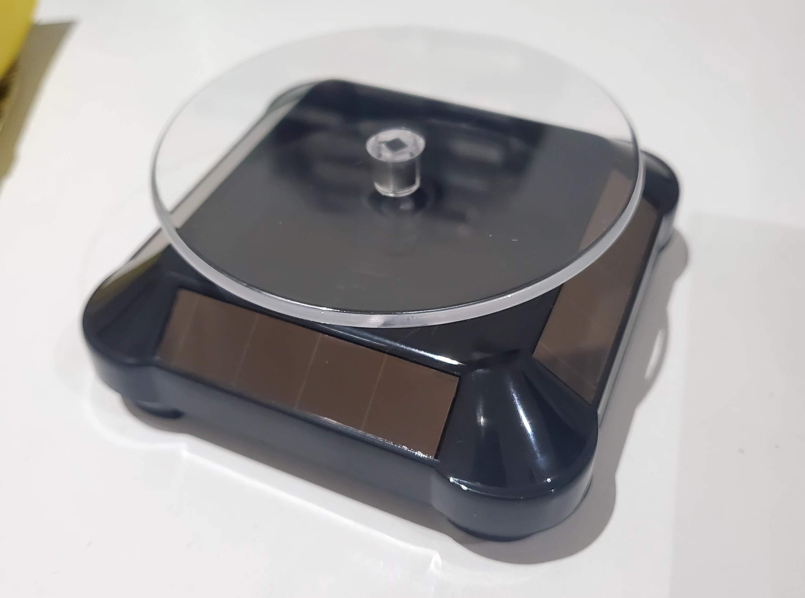

When I first got into resin printing, I found the whole process extremely messy and tedious. There were also so many chances for something to go catastrophically wrong. In light of this, I didn't want to invest significant amounts of money into it, as my goal was only to get an idea for what it is, and if it has a viable future as a hobby. This meant I had to DIY many steps of the process, mainly around the post-processing.

Through some quick internet searching, I came across many pages which recommended that the sun is a viable alternative to a curing station, since it produces UV light. And since curing stations can cost upwards of AU$100, this was an easy solution. The only downsides were that curing can only happen when it is sunny, and it takes longer as the concentration of UV is lower outside compared to dedicated LEDs.

Looking into how a UV curing station worked, I realised it would be really easy to build my own for much less. And especially since every COVID-19 kit I had bought came with an UV torch, which just happened to be within the correct wavelength, I had a whole bunch of UV LEDs ready to go.

The COVID-19 self-test kits I had ordered were from Hough, and by reading the [instructions](https://www.tga.gov.au/sites/default/files/covid-19-rapid-antigen-self-tests-are-approved-australia-ifu-345031.pdf) I could see that the torch wavelength should be 365nm, as this is the wavelength the test reacts to. By comparing this to the range that my resin reacts to, I discovered that it lay within the range, being 355-410nm.

Since these torches are essentially free, and in huge supply, I chose to build a curing station based around them. To start, I had a look at what curing stations for sale look like, and how their LEDs are arranged. I found that most have a vertical strip, with some also having an overhang on a hinge to better illuminate the tops of objects. Based off this research, and my limited modelling skills (which I hope to work on), I decided to start with just the vertical stick design.

Firstly, I started brainstorming different ways to make the torches stay in place in the most simple way possible. I ended up using a combination of a small shelf, as well as a hole through the model with a little lip to prevent it falling out the end to hold the torches in place.

_The small shelf with the lip to prevent the torch falling out._

While making the shelves, I first tried to model them manually, which ended with a very poor, hard to replicate or re-dimension design. Because of this, I stumbled across the 'arc slot' shape under the draw menu, which allowed for the perfect shape for the shelf, all with easy to assign dimensions that aligned perfectly with the hole.

The hardest part to get right, which still has issues, was the base. Since the torches are quite heavy, and the batteries are quite far away from where they are attached to the model, it makes the design's centre of mass very far over, meaning it falls over quite regularly.

The first design I tried was a solid rectangular base, which was simple to model and would serve a solid starting point.

_The first iteration of the stand._

I quickly realised that the base was not large enough, and when loaded up with torches could not stand up correctly.

I also discovered that I had entered the dimensions on the hole and shelf incorrectly, meaning that I had to make them larger to actually fit the torches without friction. Thank goodness I put the time in to dimension properly, and I hope this serve as a lesson for everyone who doesn't already do this.

My next attempt at fixing the leg issue was also an attempt at saving time and filament by turning the large rectangular base into two small legs. This also allowed me to practice using the different forms of dimensions to make sure the angles matched, as well as the lengths.

After printing this second iteration, I found that the holes were not the correct size, but it still did not stand up on it's own when all the torches were inserted.

_The second iteration of the stand._

Although it could not stand by itself, I soon realised I could use both of the stands in combination to support the two ends of the torch, which worked wonderfully.

_The two stands used together to hold all the torches._

Now that the stand was mostly complete, I began to consider how to rotate the models so the light reaches all sides. Looking at how the proper stations achieved this, I ordered a solar turntable that can both be powered by batteries as well as the UV lights themselves. This works great, as I don't need to keep removing the battery when it is not in use.

_The solar turntable._

This also provided a potential solution to the torch issue, where the base can be held in place by the turntable and it's weight, especially when using batteries. The only issue with this method is that all the previous designs had been designed so they could be printed face down without supports, although having parts jutting out both sides means that it needs to be printed vertically with supports for all the shelves, increasing filament waste and also print time. It also has the potential to weaken the model, as the adhesion between the layers is aligned with the force from the weight of the torches, meaning it could just snap, although I can only speculate as I have not tried printing this way as of writing.

As you may have noticed, all these models were printed on my filament-based Ender 5, which highlights how much easier filament is to work with, since, especially for these non-aesthetic models, it does not require much, if any, post-processing. And, since I have limited time to spend printing and processing, it makes more sense for me.

So while I plan to try this out with prints in the future, as of writing I had no projects pressing enough or the time to actually complete them with resin, although I do plan to do a follow-up in the future about my experiences with resin printing, and comparing it to filament-based printers. Hopefully in that post, I can shed some more light (pun intended) on how effective this design is.

As always, if you liked this post, you can find all my other 3D Printing content [here](/tags/3d-printing/), as well as through the tags below or in the sidebar.
Also, please consider donating via [GitHub Sponsors](https://github.com/sponsors/hasmar04) or [PayPal](https://paypal.me/harryasmar) so I can continue making content into the future.
Finally, to get notified when new posts drop, sign up for email notifications in
the sidebar, as well as follow @crankshafttech on [Facebook](https://www.facebook.com/crankshafttech/) and [Instagram](https://www.instagram.com/crankshafttech/).

If you have any feedback or thoughts, please leave it in the comments below.

Thanks again for reading!
