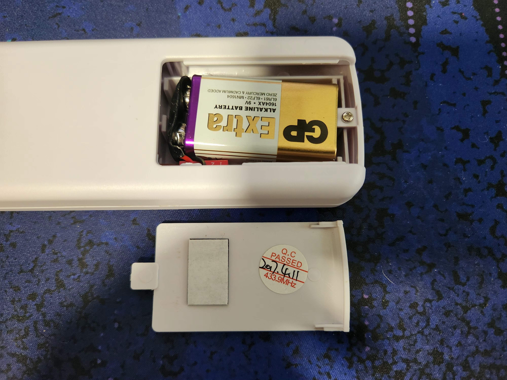
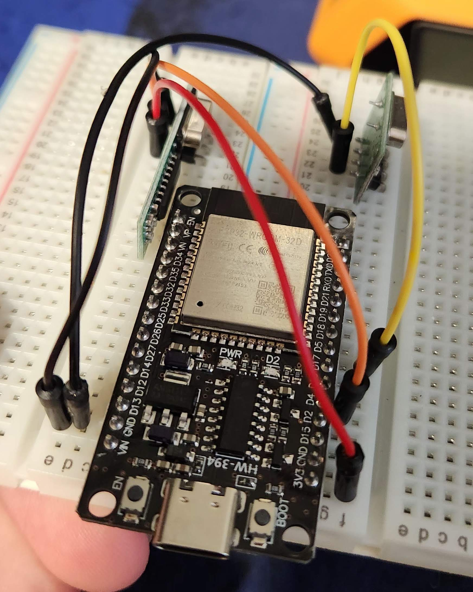
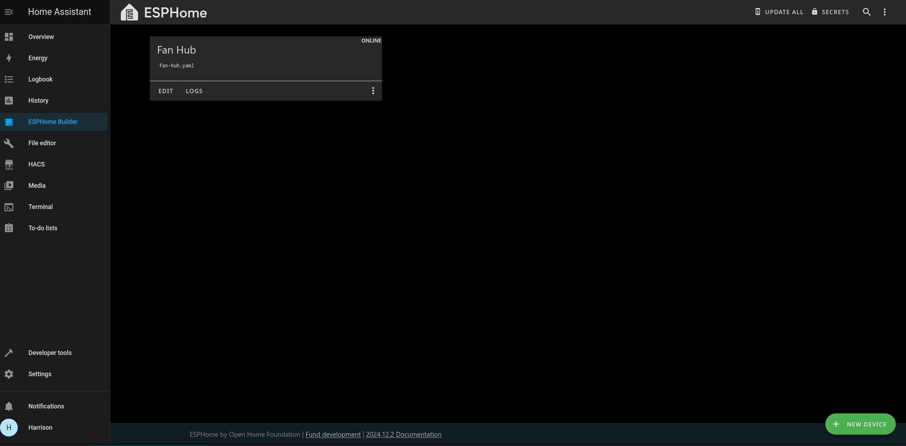
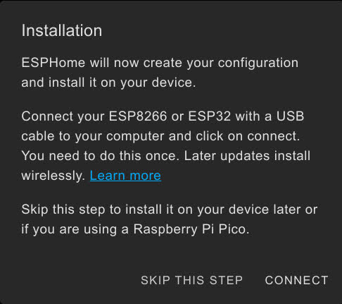
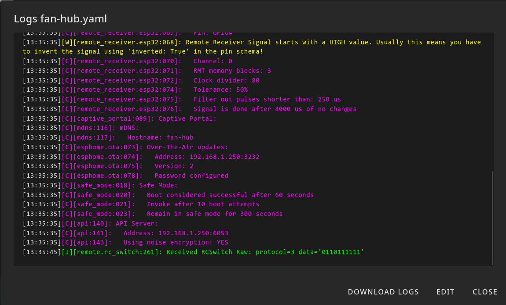
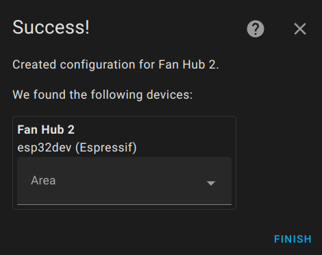
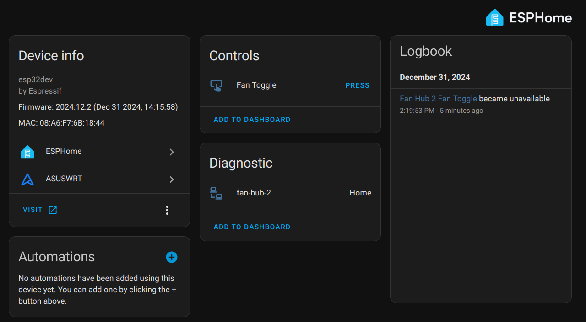

Many years ago, I purchased a WeMo Smart Light Switch for the bedroom, which at the time was an incredible piece of tech and the first piece of smart home goodness to grace my home. Many years later, I have sensors throughout, multiple smart light switches on various different rooms, and the ability to control it all with my voice. But in that time, I have also had ceiling fans installed, which are controlled via radio remotes. Surely there is a way to incorporate these into the smart home... And there is!

I would like to give a shout out to Yonatan's Dev Blog who provided the initial guidance I required to get this project rolling. You can read his guide on how he did a similar implementation in his own home [here](https://blog.yonatan.dev/controlling-ceiling-fan-home-assistant-433mhz-rf/).

## The Hardware

The first thing that needed to be identified was what frequency the fans operated on. While this can be checked with something like a Flipper Zero using the Frequency Analyzer, my remotes helpfully listed the frequency on a sticker inside the battery compartment.


_This certainly made my life a lot easier_

Now that I had confirmed that my remote operated on 433Mhz (The decimal places are not a concern), I purchased some transmitter and receiver modules off AliExpress. The exact modules I purchased can be found [here](https://vi.aliexpress.com/item/1005004187087255.html), but I recommend shopping around to see if there is a better deal.

I also purchased an ESP32 Development Board, which will features USB-C for power and firmware flashing, as well as WiFi for connecting back to Home Assistant. The exact board I purchased can be found [here](https://vi.aliexpress.com/item/1005006336964908.html), but again I recommend shopping around.

Once these parts arrived, I wired them up in the following arrangement:

|ESP32|Receiver|
|---|---|
|3V3|VCC|
|DATA (Right)|D4 (GPIO4)|
|GND|GND|

|ESP32|Receiver|
|---|---|
|D5 (GPIO5)|DATA|
|GND| - |

_Note: + does not need to be connected_



Now that the hardware was complete, it was time to move onto the software.

## The Software

While I initially attempted to go with MQTT like Yonatan's Dev Blog did, I found it quite cumbersome.

Instead, I went down the ESPHome route, which has many awesome features, including a Web Flasher, simple YAML configuration, and Over-The-Air update support, which is very handy when trying to debug and fine tune.

Please note that beyond this point, an installation of Home Assistant is required. More information can be found on the Home Assistant website [here](https://www.home-assistant.io/).

From within Home Assistant, I installed the [ESPHome Device Builder Add-on](https://esphome.io/guides/getting_started_hassio). This allows for the generation of configurations for ESPHome devices, but also for these to be installed.

Once it is installed, it can be accessed from the Home Assistant sidebar.


_While it looks simple, ESPHome is very powerful_

**Please note** that the next few steps require the use of a browser that supports WebSerial, which at the time of publishing is any Chromium-based browser, such as Google Chrome or Microsoft Edge. Hopefully Firefox adds support in the future.

From here, plug your ESP32 board into your computer and ensure that it appears as a COM port on Windows or a ttyUSB device on Mac and Linux.

Next, click on 'New Device' in ESPHome Device Builder and set a name for your device.

On the next screen, it will ask to connect to the ESP32. Click 'Connect' and follow the prompts from your browser to find your device.


_At this point, the ESP32 is connected to the ESPHome Builder_

Once the Serial port has been selected, the browser should show 'Connecting'. In my case, I had to hold the 'BOOT' button on the ESP32 board to get it to successfully start configuring. Once it shows 'Preparing installation', give it a few minutes as it creates all the necessary files. Eventually, it should change to 'Installing' which is when it is flashed to the ESP32 board.

In my case, after the install completed, ESPHome was unable to find the device on the network. To resolve this, I had to add a couple lines into the configuration file, which can be accessed by clicking 'Edit' on the device. In here, I had to add the following:

```yaml
wifi:
     ssid: !secret wifi_ssid
     password: !secret wifi_password

     manual_ip:
         static_ip: 192.168.XXX.XXX
         gateway: 192.168.XXX.XXX
         subnet: 255.255.255.0
```

Note that the above is only necessary if it does not automatically find your device. It also requires that you set this as a static lease on your router/DHCP server so that what you set in the configuration does not later become assigned to a different device.

Once the ESP32 can be successfully communicated with wirelessly, the configuration for the radios can be created.

Note: ESPHome does not auto save! Make sure to click 'Save' before closing the configuration editor.

The first configurations that needed to be added were for the ['remote_receiver'](https://esphome.io/components/remote_receiver.html) and ['remote_transmitter'](https://esphome.io/components/remote_transmitter) components. If following the pinout provided earlier in this post, the following can be appended to the configuration file:

```yaml
remote_receiver:
     pin: GPIO4
     dump:
         - rc_switch
     # Settings to optimize recognition of RF devices
     tolerance: 50%
     filter: 250us
     idle: 4ms

remote_transmitter:
     pin: GPIO5
     carrier_duty_percent: 100%
```

Further explanation of the above configuration can be found in the ESPHome documentation [here](https://esphome.io/guides/setting_up_rmt_devices#setting-up-rf-devices).

After the above configuration is entered, click 'Install' in the top right to send it to the board wirelessly. This process should take about a minute.

Now when a button is pressed on the remote to be replicated, it should appear in the log output in ESPHome.


_The green text shows a radio signal being received by the ESP32_

For each button that is pressed, at least one of the green lines in the above screenshot should appear. Note down the binary data, as well as the protocol number, as these will be required later. Also note if it says 'RCSwitch Raw' or some other code.

With this information at hand, the button can be appended to the configuration:

```yaml
button:
  - platform: template
      name: XXXXXXXXXX
      id: XXXXXXXXX

on_press:
      - remote_transmitter.transmit_XXXXXXXXXXX:
          code: '00000000000'
          protocol: X
          repeat:
            times: XX
            wait_time:
            microseconds: XXX
```

Firstly, the name is what the button will appear as in Home Assistant. Subsequently, the ID should be a lowercase, no spaces version of the name that can be used to reference this button from other things, such as switches.

Next, 'remote_transmitter.transmit_XXXXXXXXXXX' should be replaced with the relevant protocol based off the log output from earlier and the available options listed [here](https://esphome.io/components/remote_transmitter.html#remote-transmitter-actions).

After that, the code should be replaced with whatever was received as 'data' in the debug logs. Protocol should also be replaced with the number that was in the logs.

Finally, 'times' is how many repeats there should be of the transmission, and 'microseconds' is how long the pause is between each. These values will need to be tinkered with on a per-device basis to find the sweet spot between the signal not being detected by the device, and the signal being detected multiple times.

more

For each subsequent button, everything should be copied except for 'button:'. Make sure the indentation is correct when doing so to ensure that it works as intended.

Once all the changes have been made, they can be installed to the ESP32.

### Adding to Home Assistant

Once the configuration is complete, the device can be added into Home Assistant.

Firstly, make sure you know the hostname or IP Address for the ESP32.

Next, go to Settings -> Devices & services in Home Assistant, and click on 'Add Integration'. Search for 'ESPHome', and select it. Enter the hostname or IP Address from the ESP32 and click 'Submit'. Once successful, add it to a room and click 'Finish'.


_The Fan Hub successfully added into Home Assistant_

Once added, click on ESPHome, then the device. Some device info should be shown, along with the buttons that have been configured.


_The controls that were configured should appear on this page_

From here, they can be renamed (this only affects inside Home Assistant), icons can be changed and the controls can be added to a dashboard.

### Voice Assistant Control

While it is already very useful to be able to control the fans directly from Home Assistant through dashboards, many people (such as myself) want to also be able to control them using their voice.

Home Assistant did recently announce [Home Assistant Voice](https://www.home-assistant.io/voice-pe/), which allows for local voice control of your smart home, but most people use one of the big three Smart Home ecosystems; Google Home, Amazon Alexa, or Apple Homekit.

I will start with Apple Homekit as it is the most stable implementation.

Using the [Homekit Bridge integration](https://www.home-assistant.io/integrations/homekit), your buttons can be easily linked to Apple Homekit for use with Siri. However, note that control of these devices via Siri while outside your home network requires a Homekit Hub, such as a HomePod or HomePod Mini, or Apple TV 4K.

Google Home and Amazon Alexa are both similar, so I will group them together.

The traditional way of connecting Home Assistant to these services is through the cloud, either by purchasing a subscription to [Home Assistant Cloud](https://www.nabucasa.com/), or by doing it yourself.

However, I stumbled across a new method of connecting these services to Home Assistant, without having to use the cloud. It is called [Home Assistant Matter Hub](https://github.com/t0bst4r/home-assistant-matter-hub), and it utilises the relatively new [Matter standard](https://en.wikipedia.org/wiki/Matter_(standard)) which allows for devices to be inter-compatible between various smart home ecosystems. In our case, Home Assistant will emulate as a Matter Hub, which can then be added into Google Home and/or Amazon Alexa.

I will note that I have experienced some issues with this project, mostly due to it's infancy, but the majority of functionality worked straight away and it will only get better with time.

#### UPDATE: The below workaround is no longer necessary in the latest version of Home Assistant Matter Hub, as it now supports automatically converting buttons to switches!

One such issue I had was that it does not yet support buttons, which is what was used earlier for the control of the fans. To overcome this, I updated the fan_hub.yaml configuration in ESPHome to include switches, which do not show the correct state, and do the same thing whether they are turned on or off, but can behave just like a button via the Assistants:
```yaml
switch:
  - platform: template
    name: XXXXXXXXXXXXX
    turn_on_action:
      then:
        - button.press: {button_id}
    turn_off_action:
      then:
        - button.press: {button_id}
```

In the above example, the name can be whatever you want it to appear as by default in Home Assistant and Google Home/Amazon Alexa. Then, the {button_id} is the id that was set for the button you want to be pressed when the switch is toggled. Set both to the same button so whether it thinks the switch is on or off, it will do the same action.  Once this is done, connect the Matter Hub add-on to your smart home ecosystem, and command away! Future Improvements
While my current implementation does work, I hope to create a PCB for the design to make it simpler and neater, and then also a case so that it can be a more permanent solution. Unfortunately the Arduino board I chose off AliExpress is not in the default KiCAD libraries, nor easily available online for import, so I will have to design my own components, which is well beyond the scope of this post. 

## Conclusion

I have a couple other Smart Home projects in the works, so if you found this interesting please let me know in the comments!
As always, if you liked this post, you can find similar content through the tags below or in the sidebar.
Also, please consider donating via [GitHub Sponsors](https://github.com/sponsors/hasmar04) or [PayPal](https://paypal.me/harryasmar) so I can continue making content into the future.
Finally, to get notified when new posts drop, sign up for email notifications in the sidebar, as well as follow @crankshafttech on [Facebook](https://www.facebook.com/crankshafttech/) and [Instagram](https://www.instagram.com/crankshafttech/). If you have any feedback or thoughts, please leave it in the comments below. Thanks again for reading!
